# 00 — App map and information architecture (AFA mobile app)

Date: 2026-11-18
Author: strategy (flows for the pitch package)
Status: **DRAFT pitch input. Not approved.** Gate 1 (brief) is not passed. These are task flows at screen/step level, not visual UI. No user research exists yet: every structural choice below is an **assumption** to test.

Sources: feature IDs from `studio/strategy/2026-11-18-app-features-mvp-roadmap.md` [RM]. Desk research [REC], [BM], [DR] as cited there. Journeys live in `studio/research/2026-11-18-journey-maps.md`. Decisions from `studio/decisions.md`. MVP/V2 labels follow the canonical scope table in RM; where a flow and RM disagree, RM wins.

## Decided (studio lead, 2026-11-18, `decisions.md`)
- **Distribution model C.** AFA-branded app + the same assistance engine exposed to partners. Flows 02 (SOS), 03 (roadside + tracking) and 05 (claim + tracking) are designed as self-contained modules on that engine, so a partner can embed them. **Partner embed pilot = V2.**
- **AI lead = agent copilot (AI9) + FR/AR cover assistant (AI1 text).** Both are MVP pilots (flows 08 and 07). Darija voice stays V2 (flow 09).
- **WhatsApp = optional channel**, not core scope. Where a flow shows WhatsApp, it is only as a share target or an optional add-on.
- **Smart document check = OCR + rules** (AI5: passport OCR + Schengen rule check). It is not presented as AI.
- **Medical red-flag routing is a case-system rule** and agent protocol. It works with or without the copilot. The copilot can only add alerts (flow 08).

## How to read this folder
| File | Flow | Version | Roadmap features |
|---|---|---|---|
| 00-app-map.md | App map, navigation, shared rules | MVP + V2 marked | all |
| rtl-conventions.md | FR/AR and RTL defaults: digits, plates, dates, SOS position | MVP, provisional | X9, X10 |
| 01-onboarding-cover-activation.md | Onboarding, OTP, activate cover, consent centre | MVP | X1, X13, X9, X10 |
| 02-sos-one-tap.md | SOS call first, with and without login, for someone else, bereavement route | MVP | X3, X7, X11 |
| 03-roadside-request-case-tracking.md | Roadside request and status tracking | MVP | R1, R6, X4, X7 |
| 04-buy-travel-cover-visa-certificate.md | Quote, passport scan, smart document check, card payment, certificate | MVP | T1, T2, AI5, X6, X2 |
| 05-travel-claim-declaration.md | Travel claim with consent, documents and tracking | MVP | T7, X4, X7, X13 |
| 06-policy-wallet-offline-companion.md | Wallet and offline travel companion | MVP | X2, T3, X11 |
| 07-ai-cover-assistant.md | AI cover assistant, FR/AR text, public and cover modes, hand-off | MVP pilot | AI1 (text) |
| 08-agent-copilot.md | Backstage: agent console, red-flag rule, copilot | MVP pilot | AI9 |
| 09-v2-guided-declaration-voice-photo.md | Guided declaration by voice/photo, Darija pilot | **V2** | AI2, AI1-voice |

## App map

Legend: solid = MVP. Dashed grey = V2. Green = reachable without login. The SOS bar is on every screen, logged in or not, including the app lock screen.

```mermaid
flowchart TD
    LAUNCH(["App launch"]) --> D0{"Already logged in?"}
    D0 -->|"No"| LANG["Language picker FR / AR"]
    D0 -->|"Yes"| LOCK["App lock screen: biometric or PIN. SOS bar works without unlock"]
    LANG --> WELCOME["Welcome"]
    LOCK --> HOME

    subgraph PUBLIC["Reachable without login"]
        WELCOME
        LOCK
        SOSG["SOS guest, call first (X3)"]
        NUMS["Emergency numbers, offline (T3, X11)"]
        QUOTE["Travel quote, browse only (T1)"]
        ASKPUB["Ask a question: assistant, general product questions (AI1 public mode)"]
        LOGIN["Log in / sign up with OTP (X1)"]
        LEGAL["Privacy notice and terms (X13)"]
    end

    WELCOME --> SOSG
    WELCOME --> NUMS
    WELCOME --> QUOTE
    WELCOME --> ASKPUB
    WELCOME --> LOGIN
    WELCOME --> LEGAL
    LOCK --> SOSG
    LOGIN --> SOSG
    QUOTE --> ASKPUB
    QUOTE -->|"Buy needs an account"| LOGIN
    LOGIN --> ACTIVATE["Activate cover: policy no., certificate no., partner code (X1)"]
    ACTIVATE --> HOME

    subgraph APP["Logged-in app: bottom tabs + SOS bar"]
        HOME["Tab 1 Home: cover status, active case, quick actions"]
        HELP["Tab 2 Help"]
        WALLET["Tab 3 Wallet"]
        TRAVEL["Tab 4 Travel"]
        PROFILE["Tab 5 Profile"]
    end

    SOSBAR{{"SOS bar above the tab bar on every screen (X3)"}}
    SOSBAR --> SOSL["SOS logged in: call first, case in background (X3)"]
    HOME --> SOSBAR

    HELP --> ROAD["Roadside request (R1)"]
    HELP --> CASES["My cases: status timeline (X4)"]
    HELP --> CLAIM["Declare travel claim (T7)"]
    HELP --> SOSL
    HELP --> BEREAVE["A relative has died: talk to a person now"]
    ROAD --> CASES
    CLAIM --> CASES
    SOSL --> CASES

    WALLET --> COVER["Cover detail: digital card, limits, documents (X2)"]
    COVER --> PDF["Certificate PDF and share (T2)"]
    COVER --> ASK["Ask about my cover: assistant FR/AR text, cover mode (AI1)"]
    ASK -->|"Hand-off"| HUMAN["Call 24/7 or callback, per flow 07 rules"]
    ASKPUB -->|"Hand-off"| HUMAN
    WALLET --> PASS["Add to Apple / Google Wallet (X2, Should)"]

    TRAVEL --> BUY["Buy cover: quote, passport scan with smart document check, pay (T1, AI5, X6)"]
    BUY --> PDF
    TRAVEL --> COMP["Travel companion, offline (T3, X11)"]
    COMP --> NUMS

    PROFILE --> CONSENT["Consent and privacy centre (X13)"]
    PROFILE --> LANGSET["Language, text size, SOS confirm setting, notifications (X9, X10, X7)"]
    PROFILE --> VEH["My vehicles (R6, Should)"]
    PROFILE --> AGENCY["Agency finder (X12, Could)"]

    subgraph V2["V2: not in MVP"]
        TRACK["Live provider map and ETA (R2)"]
        HOMEREQ["Home emergency request (H1, H2)"]
        MED["Medical request and teleconsultation (M1, M2)"]
        FUN["Funeral declaration in app, human-led (F1, F2)"]
        CHAT["Chat with a person (X5)"]
        FAM["Family and dependants (X8)"]
        ALERTS["Travel alerts (T4, AI6)"]
        VOICE["Guided declaration by voice/photo, Darija pilot (AI2, AI1-voice)"]
        EMBED["Partner embed pilot: SOS, roadside, claim modules in a partner app"]
    end

    CASES -.-> TRACK
    HELP -.-> HOMEREQ
    HELP -.-> MED
    BEREAVE -.-> FUN
    HELP -.-> VOICE
    ASK -.-> CHAT
    PROFILE -.-> FAM
    TRAVEL -.-> ALERTS

    subgraph BACK["Backstage, not in the app"]
        ENGINE["Assistance engine and case system: red-flag rules (model C)"]
        CONSOLE["Agent console + copilot (AI9)"]
    end
    SOSG --> ENGINE
    SOSL --> ENGINE
    ROAD --> ENGINE
    CLAIM --> ENGINE
    HUMAN --> ENGINE
    BEREAVE --> ENGINE
    ENGINE --> CONSOLE
    ENGINE -.-> EMBED

    classDef pub fill:#e6f4ea,stroke:#2e7d32
    classDef v2 fill:#f2f2f2,stroke:#9e9e9e,stroke-dasharray: 5 5,color:#555
    classDef back fill:#e8eaf6,stroke:#3949ab
    class WELCOME,LOCK,SOSG,NUMS,QUOTE,ASKPUB,LOGIN,LEGAL pub
    class TRACK,HOMEREQ,MED,FUN,CHAT,FAM,ALERTS,VOICE,EMBED v2
    class ENGINE,CONSOLE back
```

## Navigation choices (assumptions to test)
| # | Choice | Why | Test |
|---|---|---|---|
| N1 | 5 bottom tabs: Home, Help, Wallet, Travel, Profile | Matches the three MVP promises: help, cover, travel [RM 4.3]. Table stakes pattern [BM 1] | Card sort / tree test with S1 and S2 users, FR and AR |
| N2 | SOS is a **fixed full-width bar** above the tab bar (bottom of screen where there are no tabs), not a tab and not a floating button | One tap from anywhere, including before login and on the app lock screen [RM X3]. Reserved layout space: never covers content or focus (2.4.11), reflows at 320 px (1.4.10). Details in `rtl-conventions.md` R7 | First-click test under time pressure; accidental-tap rate in pilot |
| N3 | AI assistant has no tab. It opens from a cover, the quote screen or a question | AI sits inside a workflow, never as a separate AI screen [RM 3.1] | Concept test of AI1 |
| N4 | Travel is a full tab | Only direct revenue case [RM O7]. Wrong for partner-only users (S2) | Open question Q-IA1 |
| N5 | Quote browsing and general product questions without login; account required at "buy" | Lowers drop-off before price is seen; account needed for certificate and wallet (A) | Funnel analytics after launch |

## Shared rules for all flows
1. **SOS is never blocked or delayed.** Not by login, app lock, coverage, expired policy, unpaid premium, missing consent, app update, GPS or network. **The call starts first;** location and case creation follow in the background (flow 02).
2. **The 24/7 number is always visible as text and tap-to-call**, separate from the office-hours number. Today the site mixes them [DR O-U7, O-C1]. Which number is 24/7: **open question** [DR N4].
3. **Edge-state codes** used in every flow:

| Code | Edge state | Default behaviour |
|---|---|---|
| E-NET | No data network | Show offline banner with last-sync time. Keep calls and SMS. Save drafts. Retry when back. |
| E-GPS | Location denied or unavailable | Ask once in context with a reason. Offer manual address, landmark or "tell the agent". Never block. |
| E-OTP | OTP not received or wrong | Resend after a visible timer. Voice-call OTP as alternative (A). Lock after N tries with a human route. |
| E-PAY | Payment fails or status unknown | Check status before any retry. Never charge twice. Offer another card. |
| E-POL | Policy not found | Check format, try another method, then human check. Never a dead end. |
| E-COV | Out of coverage (territory, dates, exclusion, limit) | Say what the app sees, in plain words. A person decides. Never refuse help in an emergency. |
| E-HRS | After hours | 24/7 line for help. Non-urgent work (claims review, activation checks) says when a person will reply. Abroad or during an active trip: hand-off goes to the 24/7 line, not a next-day callback. |
| E-LOAD | Waiting for a server (quote, policy lookup, AI answer, case creation, status, upload) | Spinner or skeleton + text saying what is happening. After 3 s: "Still working". At the step timeout (A: 10–15 s): retry, save draft, or call 24/7. Status announced (4.1.3). **Never on the SOS path before the call.** |
| E-SES | Session expires during purchase or claim | Draft kept on device. Re-login (biometric, PIN or OTP) returns to the same step. Payment is never re-submitted without a status check (E-PAY). |

4. **Human-in-the-loop:** no AI makes a decision on cover, claims, payment, dispatch or health [RM 3.1]. The AI column in each step table says what AI does and who confirms. Red-flag routing is a case-system rule, not an AI feature.
5. **Accessibility (WCAG 2.2 AA):** targets at least 24×24 CSS px (2.5.8), SOS at 48×48 dp; no cognitive tests at login (3.3.8); no gesture-only actions (2.5.1, 2.5.7); status messages announced (4.1.3); text resize to 200% without loss (1.4.4); reflow at 320 px (1.4.10); focus never hidden by the SOS bar, which has reserved space (2.4.11); any countdown can be turned off or adjusted (2.2.1); motion and haptics follow the OS reduced-motion setting.
6. **Third-party surfaces are vendor requirements.** The app cannot fix pages it does not own. Selection criteria for vendors: 3-D Secure / payment pages usable in AR (RTL) and with a screen reader; certificate and contract PDFs tagged and accessible (PDF/UA, A) with an HTML equivalent in the app. Written into the engine and payment contracts as acceptance criteria.
7. **FR/AR and RTL:** provisional defaults in `rtl-conventions.md` (Western digits 0–9 in FR and AR, plates as on Moroccan plates, Gregorian dates, SOS bar position). Phone, policy, plate, IBAN and passport data stay LTR inside RTL text (bidi isolation). Latin names from passports stay in Latin script.
8. **Ratings and surveys are gentle and optional.** One optional question on the closed case screen, skippable, never a blocking pop-up, never pushed more than once. **No rating, survey or marketing** on bereavement cases, refused cases, or cases where life was in danger, unless the client decides otherwise.
9. **Legal and regulatory statements** (law 09-08, CNDP, ACAPS) in these flows come from desk research. Each one is marked **"to confirm by legal counsel"** and is not a rule until AFA compliance confirms it.
10. **Notifications:** push first, SMS for critical steps (case created, provider assigned, certificate issued, payment) [RM X7].

## Screen inventory (IDs used in the flow files)
| Prefix | Area | Login | Version |
|---|---|---|---|
| ONB-xx | Onboarding and activation | No → Yes | MVP |
| SOS-xx | SOS | No | MVP |
| RSA-xx | Roadside request | Yes | MVP |
| CASE-xx | Case tracking | Yes (guest SOS sees a reference only) | MVP |
| BUY-xx | Travel purchase | Quote no, buy yes | MVP |
| CLM-xx | Travel claim | Yes | MVP |
| WAL-xx | Wallet and companion | Yes (numbers page: no) | MVP |
| AIA-xx | AI cover assistant | Public mode no, cover mode yes | MVP pilot |
| CON-xx | Agent console (backstage) | Staff | MVP pilot |
| GD-xx | Guided declaration | Yes | V2 |

## Open questions (IA level)
- Q-IA1. Partner-only users (S2): do they see the Travel tab? Do they see AFA or the partner brand (co-branding) [RM 5.2]? Decide before UI.
- Q-IA2. Resolved provisionally: Western digits 0–9 in FR and AR (`rtl-conventions.md` R1). To test with users.
- Q-IA3. English UI at launch: yes or no [RM 8.5]?

## Changelog 2026-11-18 (critic fixes)
- Finding 4: decided items moved out of open questions into "Decided" (model C with V2 partner embed pilot, AI lead, WhatsApp optional, smart document check = OCR + rules, red-flag rule). Old Q-IA4 and Q-IA5 removed.
- Finding 12: added E-LOAD and E-SES states; app lock screen with SOS drawn in the map.
- Finding 13: SOS is a fixed bar with reserved space, not a floating button; countdown rule; vendor accessibility requirements (3-D Secure, PDF).
- Finding 14: RTL defaults moved to the new `rtl-conventions.md`; Q-IA2 resolved provisionally.
- Finding 9: "A relative has died" route; rule 8 on ratings.
- Finding 11: assistant public mode before login; E-HRS hand-off to 24/7 abroad.
- Finding 7: rule 9, legal statements "to confirm by legal counsel".
- Finding 10: MVP/V2 labels defer to the canonical scope table in RM.
