# 00 — App map and information architecture (AFA mobile app)

Date: 2026-11-18
Author: strategy (flows for the pitch package)
Status: **DRAFT pitch input. Not approved.** Gate 1 (brief) is not passed. These are task flows at screen/step level, not visual UI. No user research exists yet: every structural choice below is an **assumption** to test.

Sources: feature IDs from `studio/strategy/2026-11-18-app-features-mvp-roadmap.md` [RM]. Desk research [REC], [BM], [DR] as cited there. Journeys (emotions, moments, channels) live in `studio/research/2026-11-18-journey-maps.md`. This folder does not repeat them.

## How to read this folder
| File | Flow | Version | Roadmap features |
|---|---|---|---|
| 00-app-map.md | App map, navigation, shared rules | MVP + V2 marked | all |
| 01-onboarding-cover-activation.md | Onboarding, OTP, activate cover, consent centre | MVP | X1, X13, X9, X10 |
| 02-sos-one-tap.md | SOS with and without login | MVP | X3, X7, X11 |
| 03-roadside-request-case-tracking.md | Roadside request and status tracking | MVP | R1, R6, X4, X7 |
| 04-buy-travel-cover-visa-certificate.md | Quote, passport scan, Schengen check, card payment, certificate | MVP | T1, T2, AI5, X6, X2 |
| 05-travel-claim-declaration.md | Travel claim with documents and tracking | MVP | T7, X4, X7 |
| 06-policy-wallet-offline-companion.md | Wallet and offline travel companion | MVP | X2, T3, X11 |
| 07-ai-cover-assistant.md | AI cover assistant, FR/AR text, hand-off | MVP pilot | AI1 (text) |
| 08-agent-copilot.md | Backstage: call-centre agent copilot | MVP pilot | AI9 |
| 09-v2-guided-declaration-voice-photo.md | Guided declaration by voice/photo, Darija pilot | **V2** | AI2, AI1-voice |

## App map

Legend: solid = MVP. Dashed grey = V2. Green = reachable without login. The SOS button is on every screen, logged in or not.

```mermaid
flowchart TD
    LAUNCH(["App launch"]) --> LANG["Language picker FR / AR / EN-if-budget"]
    LANG --> WELCOME["Welcome"]

    subgraph PUBLIC["Reachable without login"]
        WELCOME
        SOSG["SOS guest (X3)"]
        NUMS["Emergency numbers, offline (T3, X11)"]
        QUOTE["Travel quote, browse only (T1)"]
        LOGIN["Log in / sign up with OTP (X1)"]
        LEGAL["Privacy notice and terms (X13)"]
    end

    WELCOME --> SOSG
    WELCOME --> NUMS
    WELCOME --> QUOTE
    WELCOME --> LOGIN
    WELCOME --> LEGAL
    QUOTE -->|"Buy needs an account"| LOGIN
    LOGIN --> ACTIVATE["Activate cover: policy no., certificate no., partner code (X1)"]
    ACTIVATE --> HOME

    subgraph APP["Logged-in app: bottom tabs"]
        HOME["Tab 1 Home: cover status, active case, quick actions"]
        HELP["Tab 2 Help"]
        WALLET["Tab 3 Wallet"]
        TRAVEL["Tab 4 Travel"]
        PROFILE["Tab 5 Profile"]
    end

    SOSBTN{{"Persistent SOS button on every screen (X3)"}}
    SOSBTN -.-> SOSL["SOS logged in: call + GPS + case (X3)"]
    HOME -.-> SOSBTN

    HELP --> ROAD["Roadside request (R1)"]
    HELP --> CASES["My cases: status timeline (X4)"]
    HELP --> CLAIM["Declare travel claim (T7)"]
    HELP --> SOSL
    ROAD --> CASES
    CLAIM --> CASES
    SOSL --> CASES

    WALLET --> COVER["Cover detail: digital card, limits, documents (X2)"]
    COVER --> PDF["Certificate PDF and share (T2)"]
    COVER --> ASK["Ask about my cover: AI assistant FR/AR text (AI1)"]
    ASK -->|"Hand-off"| HUMAN["Callback or call a person"]
    WALLET --> PASS["Add to Apple / Google Wallet (X2, Should)"]

    TRAVEL --> BUY["Buy cover: quote, scan passport, pay (T1, AI5, X6)"]
    BUY --> PDF
    TRAVEL --> COMP["Travel companion, offline (T3, X11)"]
    COMP --> NUMS

    PROFILE --> CONSENT["Consent and privacy centre (X13)"]
    PROFILE --> LANGSET["Language, text size, notifications (X9, X7)"]
    PROFILE --> VEH["My vehicles (R6, Should)"]
    PROFILE --> AGENCY["Agency finder (X12, Could)"]

    subgraph V2["V2: not in MVP"]
        TRACK["Live provider map and ETA (R2)"]
        HOMEREQ["Home emergency request (H1, H2)"]
        MED["Medical request and teleconsultation (M1, M2)"]
        FUN["Funeral declaration, human-led (F1, F2)"]
        CHAT["Chat with a person (X5)"]
        FAM["Family and dependants (X8)"]
        ALERTS["Travel alerts (T4, AI6)"]
        VOICE["Guided declaration by voice/photo, Darija pilot (AI2, AI1-voice)"]
    end

    CASES -.-> TRACK
    HELP -.-> HOMEREQ
    HELP -.-> MED
    HELP -.-> FUN
    HELP -.-> VOICE
    ASK -.-> CHAT
    PROFILE -.-> FAM
    TRAVEL -.-> ALERTS

    subgraph BACK["Backstage, not in the app"]
        CONSOLE["Agent console + copilot (AI9)"]
    end
    SOSG --> CONSOLE
    SOSL --> CONSOLE
    ROAD --> CONSOLE
    CLAIM --> CONSOLE
    HUMAN --> CONSOLE

    classDef pub fill:#e6f4ea,stroke:#2e7d32
    classDef v2 fill:#f2f2f2,stroke:#9e9e9e,stroke-dasharray: 5 5,color:#555
    classDef back fill:#e8eaf6,stroke:#3949ab
    class WELCOME,SOSG,NUMS,QUOTE,LOGIN,LEGAL pub
    class TRACK,HOMEREQ,MED,FUN,CHAT,FAM,ALERTS,VOICE v2
    class CONSOLE back
```

## Navigation choices (assumptions to test)
| # | Choice | Why | Test |
|---|---|---|---|
| N1 | 5 bottom tabs: Home, Help, Wallet, Travel, Profile | Matches the three MVP promises: help, cover, travel [RM 4.3]. Table stakes pattern [BM 1] | Card sort / tree test with S1 and S2 users, FR and AR |
| N2 | SOS is a persistent button, not a tab | Must be one tap from anywhere, including before login [RM X3] | First-click test under time pressure |
| N3 | AI assistant has no tab. It opens from a cover or a question | AI sits inside a workflow, never as a separate AI screen [RM 3.1] | Concept test of AI1 |
| N4 | Travel is a full tab | Only direct revenue case [RM O7]. Wrong for partner-only users (S2) | Hide or demote Travel for partner-only users? Open question Q-IA1 |
| N5 | Quote browsing without login; account required at "buy" | Lowers drop-off before price is seen; account needed for certificate and wallet (A) | Funnel analytics after launch |

## Shared rules for all flows
1. **SOS is never blocked.** Not by login, coverage, expired policy, unpaid premium, missing consent or app update.
2. **The 24/7 number is always visible as text and tap-to-call**, separate from the office-hours number. Today the site mixes them [DR O-U7, O-C1]. Which number is 24/7: **open question** [DR N4].
3. **Edge-state codes** used in every flow:

| Code | Edge state | Default behaviour |
|---|---|---|
| E-NET | No data network | Show offline banner with last-sync time. Keep calls and SMS. Save drafts. Retry when back. |
| E-GPS | Location denied or unavailable | Ask once in context with a reason. Offer manual address, landmark or "tell the agent". Never block. |
| E-OTP | OTP not received or wrong | Resend after a visible timer. Voice-call OTP as alternative (A). Lock after N tries with a human route. |
| E-PAY | Payment fails or status unknown | Check status before any retry. Never charge twice. Offer another card. |
| E-POL | Policy not found | Check format, try another method, then human check. Never a dead end. |
| E-COV | Out of coverage (territory, dates, exclusion, limit) | Say what the app sees, in plain words. A person decides. Never refuse help in an emergency. |
| E-HRS | After hours | 24/7 line for help. Non-urgent work (claims review, activation checks) says when a person will reply. |

4. **Human-in-the-loop:** no AI makes a decision on cover, claims, payment, dispatch or health [RM 3.1]. The AI column in each step table says what AI does and who confirms.
5. **Accessibility (WCAG 2.2 AA):** targets at least 24×24 CSS px (2.5.8), no cognitive tests at login (3.3.8), no gesture-only actions (2.5.1, 2.5.7), status messages announced (4.1.3), text resize to 200% without loss (1.4.4), focus not hidden by sticky SOS button (2.4.11).
6. **FR/AR and RTL:** Arabic UI is mirrored. Phone numbers, policy numbers, plates, IBAN and passport data stay left-to-right inside RTL text (bidi isolation). Latin names from passports stay in Latin script. Digit style (Western 0–9 vs Eastern Arabic) is an **open question** Q-IA2.
7. **Notifications:** push first, SMS for critical steps (case created, provider assigned, certificate issued, payment) [RM X7].

## Screen inventory (IDs used in the flow files)
| Prefix | Area | Login | Version |
|---|---|---|---|
| ONB-xx | Onboarding and activation | No → Yes | MVP |
| SOS-xx | SOS | No | MVP |
| RSA-xx | Roadside request | Yes | MVP |
| CASE-xx | Case tracking | Yes (guest SOS sees a reference only) | MVP |
| BUY-xx | Travel purchase | Quote no, buy yes | MVP |
| CLM-xx | Travel claim | Yes | MVP |
| WAL-xx | Wallet and companion | Yes (numbers page: no) | MVP |
| AIA-xx | AI cover assistant | Yes | MVP pilot |
| CON-xx | Agent console (backstage) | Staff | MVP pilot |
| GD-xx | Guided declaration | Yes | V2 |

## Open questions (IA level)
- Q-IA1. Partner-only users (S2): do they see the Travel tab? Do they see AFA or the partner brand (co-branding) [RM 5.2]?
- Q-IA2. Arabic digits: Western or Eastern? Test with users.
- Q-IA3. English UI at launch: yes or no [RM 8.5]?
- Q-IA4. Is WhatsApp a companion channel [RM 5.6]? If yes, SOS, claims and status gain a WhatsApp entry. Not drawn here.
- Q-IA5. Distribution model A/B/C [RM 5.2]. If B or C, flows 02, 03 and 05 must also work as an SDK inside partner apps. Design them as self-contained modules.
