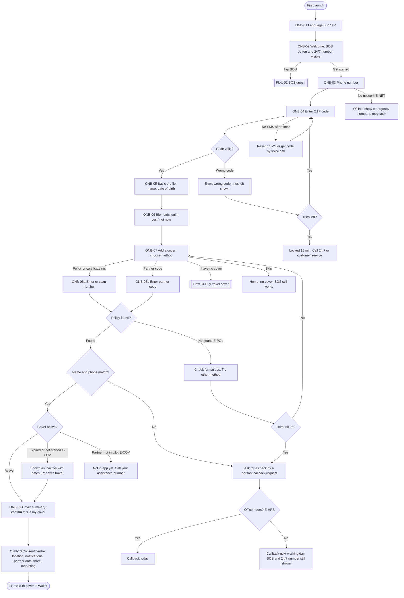

# 01 — Onboarding and cover activation (MVP)

Status: DRAFT pitch input. Assumptions marked (A). Open questions marked (Q).
Roadmap features: **X1** account and onboarding, **X13** consent and privacy centre, **X9** FR/AR + RTL, **X10** accessibility, **X7** SMS [RM 2.1, MVP items 1, 10, 11].

## Goal
A person gets from first launch to a linked, active cover in under 3 minutes (A, target to set after baseline), with SOS available at every second.

## Entry points
- First launch from the app store.
- SMS or email link after a travel purchase on web or at an agency (deep link carries the certificate number) (A).
- SMS link sent by the pilot partner to its beneficiaries, with a partner code (A; depends on contact rights [REC C1]).
- Wallet empty state: "Add a cover".
- Purchase flow (04) when a guest reaches "Buy".

## Preconditions
- Mobile number able to receive SMS. Foreign numbers (diaspora, foreign residents): **Q**.
- For partner beneficiaries: the partner shares eligibility data (policy number, phone, name) with AFA. **Q** [RM 7.2 Q2].
- AFA policy data reachable by API in real time or near real time. **Q** [RM 7.2 Q4].

## Flow

## Step table
| # | Screen | User action | System response | AI involvement / human-in-the-loop | Notes (accessibility, FR/AR RTL) |
|---|---|---|---|---|---|
| 1 | ONB-01 Language | Picks FR or AR | Sets UI language and direction. Saves on device | None | Language names in their own script ("Français", "العربية"). Changeable later in Profile. Default from device language (A) |
| 2 | ONB-02 Welcome | Reads value proposition. Taps "Get started" or SOS | SOS and 24/7 number shown before any form | None | SOS reachable with screen reader as first or second focus item. No auto-playing carousel (2.2.2) |
| 3 | ONB-03 Phone number | Enters number. Country code preselected +212 | Validates format. Sends OTP by SMS | None | Number field LTR inside RTL. Input type tel. Explains why the number is needed |
| 4 | ONB-04 OTP | Enters 6 digits or autofill | Verifies. Resend timer 30 s (A). Max 5 tries (A) | None | Autofill one-time-code (iOS/Android). No CAPTCHA (3.3.8). Timer readable and adjustable or long enough (2.2.1). Error text, not colour only |
| 5 | E3 Resend / voice | Taps resend or "Call me with the code" | New code by SMS or voice call | None | Voice OTP in FR and AR (A). Abroad, SMS may fail on roaming: voice or email fallback **Q** |
| 6 | ONB-05 Profile | Enters name, date of birth | Stores. Used for policy match | None | Minimum data only (09-08 minimisation). Names in Latin or Arabic script: both accepted; match logic **Q** |
| 7 | ONB-06 Biometric | Opts in or not | Enables device biometrics | None | Never the only way in. PIN alternative |
| 8 | ONB-07 Add a cover | Chooses method | Shows examples of where to find each number | None | Picture of a certificate with the number highlighted, plus text alternative |
| 9 | ONB-08a/b Number or code | Types or scans | Calls policy lookup API | Optional on-device OCR of the number on a certificate or card (AI5 family, Should). User confirms the read value | Scan always has manual entry. Policy number LTR |
| 10 | Lookup result | — | Found / not found / mismatch / inactive / partner not in pilot | Back-office person checks mismatches and repeated failures (callback) | Never a dead end. Each error gives a next step and the 24/7 number |
| 11 | ONB-09 Cover summary | Confirms "This is my cover" | Links cover to account. Pushes it to Wallet. Caches offline copy (X11) | None | Plain-language cover summary. Dates in local format. Hijri dates? **Q** |
| 12 | ONB-10 Consent centre | Sets toggles | Records each consent with time and version | None | Location asked here with reason, and again in context at SOS if denied. Marketing off by default. Partner data share explained per partner (X13) |
| 13 | Home | — | Shows cover status and quick actions | None | Welcome message announced once to screen readers |

## Edge states covered
E-NET (step 3), E-OTP (steps 4–5), E-POL (step 10), E-COV expired / partner not in pilot (step 10), E-HRS callback (step 10). E-GPS and E-PAY: not in this flow (see 02 and 04).

## Success criteria
- Share of new accounts that link a cover within 7 days (Activation metric [RM 6]). Target: set with client after baseline.
- Median time from launch to linked cover. Target after baseline.
- OTP success on first code. Policy lookup success on first try.
- Zero onboarding screens without visible SOS.
- No WCAG 2.2 AA defects on the flow at release.

## Open questions
- Q1. Which identifiers can activate a cover: policy number, certificate number, card number, phone number alone? Per partner? [RM 7.2 Q2]
- Q2. May AFA send activation SMS to partner beneficiaries? [REC C1]
- Q3. KYC level needed for an account that only views cover vs one that buys (T1)? **Q** [RM X1]
- Q4. Foreign phone numbers and OTP abroad: supported?
- Q5. Can one person hold covers from AFA direct and from a partner in one account? (A: yes.)
- Q6. Who handles callback checks, and what are the hours? [DR N4]
