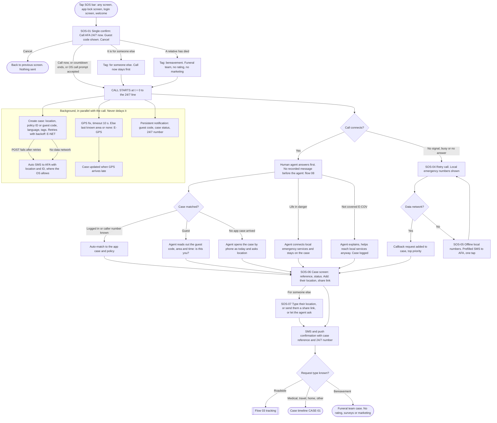

# 02 — SOS, call first (MVP)

Status: DRAFT pitch input. Assumptions (A). Open questions (Q). Redrawn 2026-11-18 after critic finding 2 (critical).
Roadmap features: **X3** SOS one-tap, **X7** push + SMS fallback, **X11** offline essentials, **X1** guest SOS [RM 2.1]. Backstage: case-system rules and **AI9** copilot (flow 08). Distribution model C: this flow is a self-contained module on the shared assistance engine, so a partner can embed it (partner embed pilot = V2).

## Goal
In one tap and at most one confirm, a person in trouble is on the phone with a human at AFA's 24/7 line. Location, identity and the case follow in the background. Nothing the app does can delay the call.

## Entry points
- **SOS bar** at the bottom of every screen, logged in or not (position: see `rtl-conventions.md` R7).
- **App lock screen** (biometric or PIN): SOS bar works without unlocking.
- **Login and sign-up screens** (flow 01), including OTP and "locked after too many tries".
- Welcome screen before login (guest).
- Wallet cover card and offline travel companion (flow 06).
- Roadside safety check "someone is hurt or in danger" (flow 03); claim "emergency still going on" (flow 05).
- AI assistant guardrail when an emergency is detected (flow 07).
- Not in MVP: device lock-screen widget, Android quick tile, iOS Lock Screen widget (V2, A).

## Preconditions
- None to start. SOS works without account, cover, consent, location or data network.
- A 24/7 line exists and its number is confirmed (Q: the site gives conflicting hours [DR O-C1, N4]).
- Case system can receive an app case by API (Q [RM 7.2 Q4]). If not, SOS still works as a plain call.

## Key design choices
1. **Call first.** The call starts at t = 0, right after the single confirm. GPS, case creation, policy lookup and SMS run in the background. None of them is a precondition, and none has a step the user must wait for.
2. **Exactly one confirm, on every platform** (A, to verify with mobile developers):
   - Android with call permission: app confirm screen SOS-01 with a 10 s countdown, "Call now" and "Cancel". The call starts directly.
   - iOS, and Android without call permission: the OS always shows its own call prompt or dialer for app-started calls. That OS step **is** the confirm. The app adds no countdown and no extra screen.
3. **Accessible cancel window (WCAG 2.2).** The countdown is a time limit, so 2.2.1 Timing Adjustable applies. We meet it by "turn off" and "adjust", not by claiming the emergency exception:
   - Default 10 s (A, to test). Long enough for a screen-reader or switch user to reach "Cancel", short enough not to slow help.
   - When a screen reader or switch access is on, there is **no countdown**: SOS-01 asks "Call now" or "Cancel". The user is never raced by a timer.
   - Profile > Accessibility: "SOS confirm" = 10 s (default) / 20 s / always ask.
   - The countdown pauses as soon as the user touches another option on the screen (e.g. "for someone else").
   - Countdown announced at start and at 5 s only, not every second (4.1.3, no audio spam). "Cancel" and "Call now" are large targets, no hold or swipe (2.5.1, 2.5.7, 2.5.8).
4. **Guest match code that the dialer cannot hide.** A guest has no policy ID and iOS cannot read the phone number. The 4-digit code is: shown large on SOS-01 **before** the call; kept in a persistent notification during the call (Android ongoing notification, iOS Live Activity, A); and shown in the agent console. **The agent reads it out** ("I see a request near Settat, code 4 8 2 1. Is that you?"), so the caller never has to find it on screen. Auto-match by caller number first when the number is known.
5. **Help for someone else.** "It is for someone else" on SOS-01 never delays the call: "Call now" stays the first button. During or after the call, the user can type the person's location or send them a share link. The app's own GPS is labelled "caller location", never "incident location".
6. **Death of a relative goes straight to a human.** "A relative has died" on SOS-01 starts the call with a bereavement tag. The case routes to the funeral team (human only), with no rating, no marketing and no surveys.
7. **Coverage is never checked before help.** The agent decides later (shared rule 1).

## Flow

## Step table
| # | Screen | User action | System response | AI / human-in-the-loop | Notes (accessibility, FR/AR RTL) |
|---|---|---|---|---|---|
| 1 | SOS bar (any screen, app lock screen, login) | Taps SOS | Opens SOS-01 (Android with permission) or SOS-01 + OS call prompt (iOS, Android without permission). Generates guest code if not logged in | None | Label "SOS" + "Urgent help", not colour only. Accessible name "SOS, call AFA for urgent help". Min 48×48 dp. On the app lock screen: no unlock needed; the app sends the stored account ID, shows no personal data |
| 2 | SOS-01 Single confirm | Taps "Call now", or lets the 10 s countdown end, or cancels. Optional: "It is for someone else", "A relative has died" | Starts the call | None | No countdown when a screen reader or switch access is on. Countdown adjustable or off in Profile (2.2.1). Pauses on interaction. Guest code large, digits LTR in AR, read digit by digit |
| 3 | Phone call (OS) | Talks to agent | Call to the 24/7 number. Abroad: international number | **Human agent answers first.** Copilot (flow 08) only assists the agent | No recording notice before the agent on SOS calls (flow 08). Roaming cost abroad: "Call me back" offered on SOS-06 when data works (A) |
| 4 | Background: location | — | GPS fix, timeout 10 s (A). On timeout: last known area with its age, or none. Location prompt only if never asked, shown **after** the call started, never before | None | E-GPS never blocks. Reason text: "So the agent knows where you are" |
| 5 | Background: case | — | POST case: location + accuracy, policy ID or guest code, UI language, tags (someone else, bereavement), battery level (A), time. Retries with backoff for 2 min (A) | None. **No AI in the SOS front line** [RM AI1 rule] | Small payload for weak networks (X11) |
| 6 | Background: SMS | — | If the case cannot be sent: Android sends an SMS to AFA automatically where store policy and permission allow (A, to verify). iOS cannot send SMS silently: after the call, SOS-05/06 offers a prefilled SMS, one tap | None | SMS text in user language + machine-readable part. Short number **Q** |
| 7 | Persistent notification | Glances at it if needed | Guest code, case status, 24/7 number | None | Readable by screen reader. Stays until the case is closed or dismissed |
| 8 | Match (agent side) | Confirms "yes, that is me" | Auto-match by account or caller number. Else agent reads candidate guest code, area and time | Agent matches. Copilot may list candidates (flow 08) | The caller never needs to read the screen while on the phone |
| 9 | SOS-04 Call failed | Retries, or requests callback | Callback added to the case at top priority. Local numbers shown at the same time | Human calls back | — |
| 10 | SOS-05 Offline numbers | Calls a local number, or sends prefilled SMS | Numbers from cached country pack (T3) | None | Works with no data |
| 11 | SOS-06 Case screen | Reads reference and status. Optional: "Call me back", add details | Status "Received", then updates from the case system | None | Status changes announced (4.1.3). Reference LTR |
| 12 | SOS-07 For someone else | Types their location (country, city, address, hospital), or sends them a share link (SMS, WhatsApp, other apps), or leaves it to the agent | Location added to the case as "reported location". Share link opens a light web page where the person can share their location in their browser, no app needed (A, new: add to canonical scope table) | Agent confirms the location by phone | Optional at every step. Never asked before the call. The person's consent is given on the web page |
| 13 | SMS + push | — | Confirmation with case reference and 24/7 number | None | SMS in UI language. Arabic SMS uses Unicode (shorter limit) |
| 14 | Case close | — | Bereavement: no rating, no survey, no marketing. Other SOS cases: an optional one-line "How did we do?" on the closed case screen, never pushed, skippable | None | See shared rule 8 in 00 |

## Edge states covered
E-GPS (background, timeout, never blocks), E-NET (auto SMS where allowed, one-tap SMS otherwise, offline numbers), call failure (retry, callback, local numbers), E-COV (agent, after the call starts, never before), E-POL (not applicable: a guest is never blocked), app locked (SOS without unlock), E-HRS (**the line is assumed 24/7**; if not, SOS must route to local emergency services after hours, **Q** [DR N4]). No E-LOAD state exists before the call: nothing loads before the call.

## Success criteria
- Time from tap to call start: under 2 s after confirm, on every network condition (QA test set).
- Time from tap to human answer (app) vs phone-only calls [RM 6 "Time to assistance"]. Target after baseline.
- Share of SOS cases that arrive with usable location; share matched to a case automatically.
- Accidental SOS rate (cancelled at SOS-01, or agent tags "pocket call").
- Zero SOS paths blocked or delayed by login, lock screen, consent, coverage, GPS or network (QA test set).

## Open questions
- Q1. Which number is the real 24/7 line, and the number to call from abroad? [DR N4]
- Q2. Can the case system receive an app case and match it by caller number or code? [RM 7.2 Q4]
- Q3. SMS short number or long number for the fallback? Who runs it?
- Q4. Medical emergency policy: when life is in danger, does the agent connect local emergency services first? Needs AFA medical team input.
- Q5. Does a partner (pilot) want SOS to call its own branded line instead of AFA's?
- Q6. Store policies: may the Android app hold call and SMS permissions for SOS? (A: call permission yes, SMS to verify.)
- Q7. Share-link page for "someone else": MVP or V2? Data retention for the reported location (to confirm by legal counsel).

## Changelog 2026-11-18 (critic fixes)
- Finding 2: redrawn call-first. Call starts at t = 0; GPS, case POST and SMS run in the background with timeouts; SMS is never a precondition. Guest code shown before the call, kept in a persistent notification, and read out by the agent.
- Finding 12: SOS from the app lock screen and the login screens specified. Background timeouts added. No loading state before the call.
- Finding 13: single confirm per platform; 10 s adjustable countdown, off for screen-reader and switch users (WCAG 2.2.1). SOS bar instead of a floating button.
- Finding 9: "It is for someone else" (location entry, share link, agent asks) and "A relative has died" (human route, no rating). Optional rating only.
- Model C: flow marked as a self-contained module for the V2 partner embed pilot.
