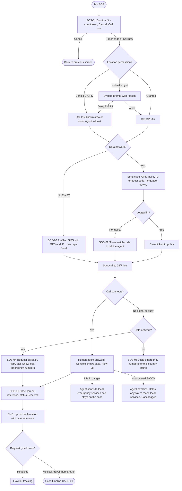

# 02 — SOS one-tap (MVP)

Status: DRAFT pitch input. Assumptions (A). Open questions (Q).
Roadmap features: **X3** SOS one-tap, **X7** push + SMS fallback, **X11** offline essentials, **X1** guest SOS [RM 2.1, MVP items 1, 2, 9, 11]. Backstage: **AI9** copilot (flow 08).

## Goal
In one tap, a person in trouble reaches a human at AFA's 24/7 line, and AFA receives their location, identity and language at the same time, with a case already open.

## Entry points
- Persistent SOS button on every screen (logged in or not).
- Welcome screen before login (guest).
- Wallet cover card and offline travel companion (flow 06).
- Roadside flow safety check "someone is hurt or in danger" (flow 03).
- AI assistant guardrail when an emergency is detected (flow 07).

## Preconditions
- None to start. SOS works without account, cover, consent or data network.
- AFA case/dispatch system can receive a case by API (Q [RM 7.2 Q4]).
- A 24/7 line exists and its number is confirmed (Q: the site gives conflicting hours [DR O-C1, N4]).

## Key design choices (assumptions)
- **Call first, data in parallel.** The call starts while the app sends GPS and identity. Nothing waits for a form.
- **Guest match code.** A guest has no policy ID and iOS cannot read the phone number. The app shows a 4-digit code to tell the agent. The agent console matches the case by code or caller number (A).
- **Short confirm step** to avoid pocket calls: a 3-second countdown with a big "Cancel", or tap "Call now" to skip the wait. No hold or swipe gesture is required (WCAG 2.5.1, 2.5.7).
- **Coverage is never checked before help.** The agent decides later (shared rule 1).

## Flow

## Step table
| # | Screen | User action | System response | AI involvement / human-in-the-loop | Notes (accessibility, FR/AR RTL) |
|---|---|---|---|---|---|
| 1 | Any screen | Taps SOS | Opens SOS-01 | None | Button label "SOS" + text "Urgent help", not colour only. Accessible name "SOS, call for urgent help". Min 44×44 pt (A, above 2.5.8 floor). Same corner in FR and AR? **Q** for testing |
| 2 | SOS-01 Confirm | Waits 3 s or taps "Call now". Can cancel | Countdown with haptic ticks | None | Countdown announced to screen readers. Cancel is large. No gesture-only action |
| 3 | System prompt (if needed) | Allows or denies location | Gets GPS fix in background, max 10 s (A) | None | Reason text before the OS prompt: "So the agent knows where you are" |
| 4 | — (background) | — | POST case: GPS + accuracy, policy ID or guest code, UI language, battery level (A), time | None. **No AI in the SOS front line** [RM AI1 rule] | Payload small for weak networks (X11). Retry 3 times silently (A) |
| 5 | SOS-02 Guest code | Reads code to the agent | Shows 4-digit code, large | None | Code readable by screen reader digit by digit. Digits LTR in AR |
| 6 | SOS-03 SMS fallback | Taps Send on prefilled SMS | SMS to AFA short number: GPS, policy ID or code, language | None | OS needs a user tap to send SMS. Text in user's language + machine-readable part. Short number **Q** |
| 7 | Phone call | Talks to agent | OS dialer opens on the 24/7 number. From abroad: international number | Human agent answers. AI9 copilot assists the agent only (flow 08) | Roaming cost abroad: offer "Call me back" when data works (A) |
| 8 | SOS-04 Call failed | Requests callback or retries | Callback request added to case with priority | Human calls back | Local numbers shown at the same time |
| 9 | SOS-05 Offline numbers | Calls a local number | Numbers from cached country pack (T3) | None | Works with no data. Content per country **Q**, kept current by AFA |
| 10 | SOS-06 Case screen | Reads reference and status | Status "Received", then updates from case system | None | Status changes announced (4.1.3). Reference LTR |
| 11 | SMS + push | — | Confirmation with case reference and 24/7 number | None | SMS in UI language. Arabic SMS uses Unicode (shorter limit) |

## Edge states covered
E-GPS (steps 3, 4), E-NET (steps 6, 9), call failure (step 8), E-COV handled by agent after the call starts (never before), E-HRS: **the line is assumed 24/7**. If it is not, SOS must route to local emergency services after hours. **Q** [DR N4]. E-POL: not applicable; a guest is never blocked.

## Success criteria
- Time from tap to human answer (app) vs phone-only calls [RM 6 "Time to assistance"]. Target after baseline.
- Share of SOS cases that arrive with usable GPS.
- Share of SOS calls matched to a case automatically.
- Accidental SOS rate (cancelled within the countdown, or agent tags "pocket call").
- Zero SOS paths blocked by login, consent or coverage (QA test set).

## Open questions
- Q1. Which number is the real 24/7 line, and the number to call from abroad? [DR N4]
- Q2. Can the case system receive an app case before the call and match it by caller number or code? [RM 7.2 Q4]
- Q3. SMS short number or long number for the fallback? Who runs it?
- Q4. Medical emergency policy: does AFA want the app to suggest local emergency services first when life is in danger? Needs AFA medical team input.
- Q5. Does a partner (pilot) want SOS to call its own branded line instead of AFA's?
- Q6. Lock-screen widget or Android quick tile for SOS: MVP or V2? (A: V2.)
