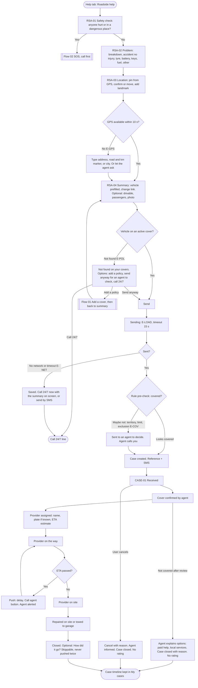

# 03 — Roadside assistance request and case tracking (MVP)

Status: DRAFT pitch input. Assumptions (A). Open questions (Q).
Roadmap features: **R1** roadside request with location, **R6** vehicle profile (MVP Should; without it the vehicle comes from the policy or is typed), **X4** case tracking (status steps, not a live map), **X7** push + SMS [RM 2.4]. Live map **R2** is V2. Model C: this flow is a self-contained module on the engine API (API1, MVP Must); partner embed pilot = V2.
Scope assumption: Isaaf Auto clients and one pilot partner [RM 4.3], subject to agreement.

## Goal
A driver with a covered vehicle gets to **request sent in under a minute (target, to test)** [RM 4.3 item 4], in **4 short screens, prefilled** (safety, problem, location, summary), and then sees each step of the case without calling. The pitch uses this wording, not "3 taps".

## Entry points
- Help tab: "Roadside help".
- Home quick action (shown when an auto cover is linked).
- Wallet: auto cover card, "Request help".
- SOS (flow 02) when the agent tags the case "roadside": the case lands here for tracking.

## Preconditions
- Logged in, auto cover linked (flow 01). Without it: SOS or call 24/7 is always offered; the request can still be sent for an agent to check.
- Vehicle known: from the policy, or from My vehicles (R6), or typed.
- Case system exposes case creation and status events by API (Q [RM 7.2 Q4]).

## Flow

## Step table
| # | Screen | User action | System response | AI / human-in-the-loop | Notes (accessibility, FR/AR RTL) |
|---|---|---|---|---|---|
| 1 | RSA-01 Safety | Answers yes / no | Yes → SOS (flow 02, call first). No → continue | None | Two big buttons. Plain text: "Is anyone hurt, or are you in a dangerous place?" |
| 2 | RSA-02 Problem | Picks one tile | Sets case type | None (AI2 guided declaration is V2, flow 09) | Icons always with text labels. Tiles reflow at 200% text |
| 3 | RSA-03 Location | Confirms pin, moves it, adds landmark | GPS fix, timeout 10 s (A); reverse-geocodes address. Loading text "Finding your location" | None | Map is not the only way: address field, "use my location" button, "let the agent ask". Map gestures have button alternatives (2.5.7) |
| 4 | RSA-04 Summary | Checks prefilled vehicle (change if needed); optional details; taps Send | Checks vehicle against active covers | None | Plate shown as on the physical plate, LTR block (`rtl-conventions.md` R4). Optional fields clearly marked optional. Send button says "Send request" |
| 5 | Vehicle not found | Adds a policy, sends anyway, or calls | Never a dead end: "send anyway" creates a case flagged for agent check | Agent checks cover | — |
| 6 | Sending | Waits | E-LOAD: "Sending your request", announced (4.1.3). Timeout → saved + call or SMS | None | — |
| 7 | Pre-check | — | Rule pre-check on cover (territory, limits). Creates case | **Rules only, no AI.** If "maybe not covered", a human agent decides. The app never refuses | — |
| 8 | Confirmation | — | Reference number. SMS + push | Agent sees the case in console; AI9 copilot may suggest provider and clause; agent confirms (flow 08) | Reference LTR |
| 9 | CASE-01 Timeline | Reads status; may call agent | Status events from the case system. Push on each step. Skeleton while loading, "last updated" time if stale | Agent assigns provider (human) | Timeline is a list, not only a graphic. Each change announced. Local time stamps |
| 10 | Delay | Calls agent or waits | Push when ETA passed; agent alerted | Human follow-up | "Call agent" always visible on CASE-01 |
| 11 | Close | Optionally answers one question | CSAT stored by case. Not shown on refused or cancelled cases | None | Labelled buttons, not stars only. Skippable. Shared rule 8 in 00 |

## Edge states covered
E-POL (vehicle not found: add, send anyway, call), E-GPS (manual address or agent asks), E-LOAD (location, sending, timeline), E-NET (saved, call or SMS), E-COV (pre-check flags, human decides; refused case ends in the timeline, no rating), delay past ETA, user cancel. E-HRS: dispatch assumed 24/7 (Q); status updates may be slower at night (A).

## Success criteria
- Request sent in under a minute (target, to test): time from opening the flow to "request sent", measured in usability sessions, then in pilot data.
- Time to assistance: request → provider dispatched, and → on site [RM 6]. Target after baseline.
- Share of roadside cases opened in app (digital case share) for the pilot partner.
- "Where is my provider?" calls per case (call deflection) [RM 5.5].
- CSAT after case (optional answers only).

## Open questions
- Q1. Does the case system expose status events, and which steps exist? The 7 steps above are assumed.
- Q2. Can the app show provider name and plate? Privacy and provider agreement.
- Q3. Is there an ETA from dispatch today? If not, show steps without ETA.
- Q4. Which roadside services and territory per contract (Morocco only, or Europe for MRE drivers)?
- Q5. Pilot partner: AFA brand, partner brand, or co-brand on these screens? [RM 5.2]

## Changelog 2026-11-18 (critic fixes)
- Finding 10: steps cut from 6 to 4 screens (vehicle and details merged into the summary, prefilled). Goal reworded to match RM 4.3: "request sent in under a minute (target, to test)", not "3 taps".
- Finding 12: dead end "vehicle not on a cover" now has exits (add policy, send anyway, call 24/7). E-LOAD states for location, sending and timeline. Refused and cancelled cases end in the timeline.
- Finding 9: rating made optional and skippable; not shown on refused or cancelled cases.
- Finding 14: plate display follows `rtl-conventions.md` R4 (open question closed provisionally).
- Model C: marked as a module for the V2 partner embed pilot.
