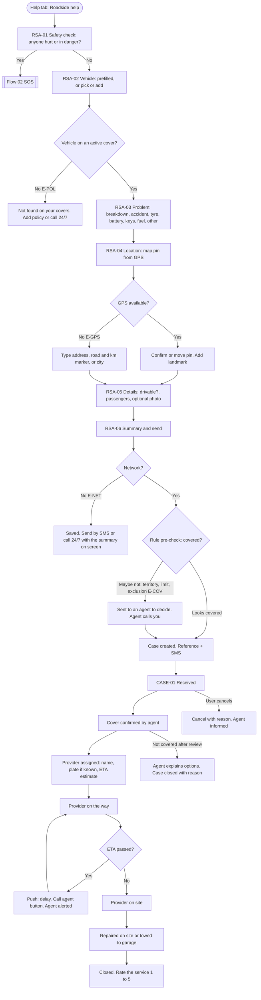

# 03 — Roadside assistance request and case tracking (MVP)

Status: DRAFT pitch input. Assumptions (A). Open questions (Q).
Roadmap features: **R1** roadside request with location, **R6** vehicle profile (Should), **X4** case tracking (status steps, not a live map), **X7** push + SMS [RM 2.4, MVP items 3, 4, 9]. Live map **R2** is V2.
Scope assumption: Isaaf Auto clients and one pilot partner (e.g. Sanlam Maroc motor) [RM 4.3], subject to agreement.

## Goal
A driver with a covered vehicle asks for roadside help in 3 taps after the location screen (A), and then sees each step of the case without calling.

## Entry points
- Help tab: "Roadside help".
- Home quick action (shown when an auto cover is linked).
- Wallet: auto cover card, "Request help".
- SOS (flow 02) when the agent or the user picks "roadside": the case lands here for tracking.

## Preconditions
- Logged in, auto cover linked and active (flow 01). Without it: SOS.
- Vehicle known: from the policy, or from My vehicles (R6), or typed.
- Case system exposes case creation and status events by API (Q [RM 7.2 Q4]).

## Flow

## Step table
| # | Screen | User action | System response | AI involvement / human-in-the-loop | Notes (accessibility, FR/AR RTL) |
|---|---|---|---|---|---|
| 1 | RSA-01 Safety | Answers yes / no | Yes → SOS (flow 02). No → continue | None | Two big buttons. Plain text: "Is anyone hurt, or are you in a dangerous place?" |
| 2 | RSA-02 Vehicle | Confirms prefilled vehicle or picks one | Checks vehicle against active covers | None | Plate shown LTR in AR. Moroccan plates mix Arabic letter and digits: display rule **Q** |
| 3 | RSA-03 Problem | Picks one tile | Sets case type | None (AI2 guided declaration is V2, flow 09) | Icons always with text labels. Tiles reflow at 200% text |
| 4 | RSA-04 Location | Confirms pin, moves it, adds landmark | Reverse-geocodes address | None | Map is not the only way: address text field and "use my location" button. Map gestures have button alternatives (2.5.7) |
| 5 | RSA-05 Details | Answers 2–3 questions, optional photo | Stores answers | None | Photo optional. Resumable upload (X11) |
| 6 | RSA-06 Summary | Taps Send | Rule pre-check on cover (territory, limits). Creates case | **Rules only, no AI.** If "maybe not covered", a human agent decides. The app never refuses | Summary readable as a list. Send button label states the action |
| 7 | Confirmation | — | Reference number. SMS + push | Agent sees the case in console; AI9 copilot suggests provider and cover clause; agent confirms (flow 08) | Reference LTR |
| 8 | CASE-01 Timeline | Reads status; may call agent | Status events from the case system. Push on each step | Agent assigns provider (human) | Timeline is a list, not only a graphic. Each change announced. Time stamps in local time |
| 9 | Delay | Calls agent or waits | Push when ETA passed; agent alerted | Human follow-up | "Call agent" always visible on CASE-01 |
| 10 | Close + rating | Rates 1–5, optional comment | CSAT stored by case | None | Rating with labelled buttons, not stars only |

## Edge states covered
E-POL (vehicle not on a cover), E-GPS (manual address), E-NET (saved, SMS or call fallback), E-COV (pre-check flags, human decides), delay past ETA, user cancel. E-HRS: dispatch assumed 24/7 (Q); status updates may be slower at night (A).

## Success criteria
- Time to assistance: request → provider dispatched, and → on site [RM 6]. Target after baseline.
- Share of roadside cases opened in app (digital case share) for the pilot partner.
- "Where is my provider?" calls per case (call deflection) [RM 5.5].
- CSAT after case.
- Median taps from RSA-03 to Send.

## Open questions
- Q1. Does the case system expose status events, and which steps exist? The 7 steps above are assumed.
- Q2. Can the app show provider name and plate? Privacy and provider agreement.
- Q3. Is there an ETA from dispatch today? If not, show steps without ETA.
- Q4. Which roadside services and territory per contract (Morocco only, or Europe for MRE drivers)?
- Q5. Pilot partner: AFA brand, partner brand, or co-brand on these screens? [RM 5.2]
