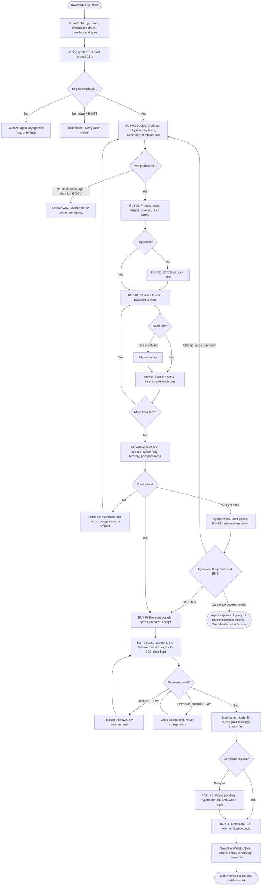

# 04 — Buy travel cover and get an instant visa certificate (MVP)

Status: DRAFT pitch input. Assumptions (A). Open questions (Q).
Roadmap features: **T1** quote and buy, **T2** instant visa certificate, **AI5** smart document check (passport OCR prefill + Schengen rule check; OCR + rules, not presented as AI), **X6** card payment, **X2** wallet [RM 2.2, MVP items 6, 7, 8].

## Critical dependency
**This flow assumes the app reuses the subscription engine behind voyage.africafirstassist.com by API** (pricing, policy issue, certificate generation) [RM 4.3 item 6, DR A6]. The studio has not seen that site (proxy 403) [REC A11]. Its steps, payment provider and certificate format are unknown.
- If the engine cannot be reused: MVP links out to the web flow at step BUY-04, and in-app T1 moves to V2 [RM 4.3].
- **To confirm by legal counsel:** whether ACAPS must be informed before online sales go live (desk research only [REC S66, S67]). The claim "zéro risque de refus" must not appear in the app until compliance reviews it [DR O-U12].

## Goal
A visa applicant gets the right Isaaf cover and a certificate the consulate accepts, in minutes, with no data errors.

## Entry points
- Travel tab: "Buy travel cover".
- Welcome screen: quote without login (flow 00, N5).
- Wallet: expired travel cover, "Renew".
- Onboarding "I have no cover" (flow 01).
- Web or SMS deep link (A).

## Preconditions
- Quote: none. Buy: account with OTP (flow 01).
- Engine API, pricing rules for 5 products, certificate service (Q).
- Card payment provider with 3-D Secure (Q [DR Q3]).

## Flow

## Step table
| # | Screen | User action | System response | AI involvement / human-in-the-loop | Notes (accessibility, FR/AR RTL) |
|---|---|---|---|---|---|
| 1 | BUY-01 Trip | Picks purpose (Schengen visa, other trip, student, resident abroad), destination, dates, number and ages of travellers | Saves draft locally | None | Date picker with typed input option. Dates shown in FR/AR format; ISO in data. Destination search accepts FR and AR names |
| 2 | BUY-02 Quotes | Compares products | E-LOAD "Getting prices" (skeleton list, announced). Engine returns **full prices** in MAD, not "from" [DR O-U1, O-U6]. Tag "meets Schengen rules" from rules | **No AI recommendation** (AI8 is later; ACAPS duty of advice, to confirm by legal counsel [RM AI8]). Tags come from rules approved by compliance | Comparison as a list per product, not a wide table, so it reflows. Prices: "1 234,00 MAD" format per locale; currency LTR isolated in AR |
| 3 | BUY-03 Product detail | Reads cover | Plain-language summary + link to general conditions | None | Headings for each cover block. PDF has an HTML equivalent (A) |
| 4 | Login | OTP (flow 01) | Returns to the same step with data kept | None | No data lost on login |
| 5 | BUY-04 Scan | Scans passport MRZ with camera, or types | **On-device OCR** reads name, date of birth, passport number, expiry | **Smart document check (AI5): OCR.** On device where possible (data protection under law 09-08, to confirm by legal counsel). User must review every field | Camera needs a manual alternative. Instructions spoken by screen reader. Names stay in Latin script as on passport, also in AR UI |
| 6 | BUY-05 Check fields | Edits or confirms each field | Highlights low-confidence fields | OCR marks fields it is unsure of. **Human = the user** confirms | Each field labelled. Errors next to the field (3.3.1) |
| 7 | BUY-06 Rule check | Reads result | Checks cover amount ≥ 30 000 € for Schengen, whole stay, territory [DR A4]; flags passport expiry before trip end | **Smart document check (AI5): rules** (deterministic, not AI). Unsure cases → agent, who answers by push and SMS; draft kept. Visa rules beyond insurance are the consulate's job; app says so | Explains each failed rule in one sentence with the fix |
| 8 | BUY-07 Pre-contract info | Reads and accepts | Records acceptance with version and time | None | Not a pre-ticked box. Text readable at 200% |
| 9 | BUY-08 Payment | Enters card, passes 3-D Secure | Provider hosted fields (A). E-LOAD "Processing payment, do not close". Session expiry (E-SES): draft kept, re-login returns here, status checked before any retry | None | **Vendor requirement:** hosted fields and 3-D Secure pages usable in AR (RTL) and with a screen reader is a payment-provider selection criterion; the bank's page is outside the app's control. Pay-at-agency code as alternative? **Q** [RM X6] |
| 10 | Payment result | Retries or continues | Status check before any retry (idempotent payment) | None | Clear money message: "You have not been charged" or "You have been charged once" |
| 11 | BUY-09 Certificate | Opens, shares, downloads | PDF with QR / verification code, in languages consulates need. E-LOAD while issuing; payment confirmation shown first | None. Issue failures go to a person | **Vendor requirement:** tagged, accessible PDF (PDF/UA, A) is an acceptance criterion for the certificate engine; the app also shows the key data as text. Certificate language rules per consulate **Q** [DR Q7] |
| 12 | Wallet | — | Cover and certificate stored and cached offline | None | See flow 06 |

## Edge states covered
E-NET (draft saved), E-LOAD (quotes, payment, certificate), E-SES (session expiry keeps draft), engine unavailable (link out), agent review (exits: buy, change, offline purchase), E-COV (no product fits), OCR failure (manual), rule mismatch (fix loop), E-PAY declined and unknown status, certificate delayed after payment, E-HRS (agent review time shown). E-GPS: not used.

## Success criteria
- Time to certificate: start of purchase → certificate issued [RM 6]. Target after baseline.
- Online travel share (app + web) of all travel sales [RM 6].
- Smart document check quality: certificate correction rate after issue [RM 6].
- Payment success on first try; zero double charges.
- Quote-to-purchase conversion, with drop-off by step.

## Open questions
- Q1. Can we reuse the voyage. engine by API (pricing, issue, certificate)? Who owns it? [RM 7.2 Q5]
- Q2. Payment provider and methods. Is pay-at-agency needed at launch? [DR Q3]
- Q3. Certificate format, languages and verification method consulates accept [DR Q7].
- Q4. KYC for online purchase: is passport data enough?
- Q5. One policy for several travellers, or one per traveller? (Family X8 is V2.)
- Q6. Has ACAPS been informed of online sales, and is that required? Which mandatory pre-contract texts? (to confirm by legal counsel)
- Q7. Refund or cancellation rule after purchase (visa refused)?

## Changelog 2026-11-18 (critic fixes)
- Finding 12: dead end "Agent review" now has exits (OK to buy, change dates or product, purchase offline). E-LOAD on quotes, payment and certificate issue; E-SES session-expiry rule.
- Finding 11 / decision: AI5 relabelled "smart document check (OCR + rules)", not AI.
- Finding 13: 3-D Secure accessibility/RTL and tagged certificate PDF written as vendor requirements.
- Finding 7: ACAPS and law 09-08 statements marked "to confirm by legal counsel".
