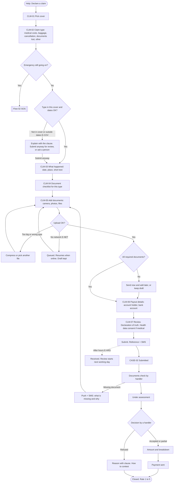

# 05 — Travel claim declaration with documents, and tracking (MVP)

Status: DRAFT pitch input. Assumptions (A). Open questions (Q).
Roadmap features: **T7** travel claims, **X4** case declare and track, **X7** notifications, **X11** resumable uploads, **X13** consent [RM 2.1, 2.2, MVP item 4]. Today: free-text web form, no upload, no tracking [DR A7, O-U9].

## Goal
A traveller sends a complete claim with all documents once, and sees where it stands until payment, without calling.

## Entry points
- Help tab: "Declare a claim".
- Wallet: travel cover, "Make a claim".
- Case screen after an SOS or medical case abroad: "Claim my expenses" (A).
- Push reminder when a handler asks for a missing document.

## Preconditions
- Logged in. Travel cover linked (flow 01 or 04).
- Claim types and document lists per product from AFA (Q). Example: baggage cover in Monde Premium [DR A3].
- Case system accepts claims and documents by API; storage under 09-08 (Q [RM X4]).

## Flow

## Step table
| # | Screen | User action | System response | AI involvement / human-in-the-loop | Notes (accessibility, FR/AR RTL) |
|---|---|---|---|---|---|
| 1 | CLM-01 Cover | Picks the cover | Loads claim types for this product | None | Only covers with claim rights shown; others explained |
| 2 | CLM-02 Type | Picks type; answers "still an emergency?" | Emergency → SOS | None | Plain labels, one question per screen |
| 3 | Eligibility pre-check | Reads result | Rules: type in cover, event within dates, declaration delay | **Rules only.** If it fails, user may still submit; a handler decides. The app never refuses a claim | Clause quoted in plain words + link to full text |
| 4 | CLM-03 Event | Enters date, place, text | Saves draft at each step | None in MVP. AI2 (structured intake from voice/photo) is V2, flow 09 | Text field accepts AR and FR. No character count trap |
| 5 | CLM-04 Checklist | Reads list | Required vs optional documents per type (from AFA) | None | Checklist is a real list with states "added / missing" |
| 6 | CLM-05 Upload | Adds files | Compresses images, resumable upload, per-file status | None | Each upload progress announced. Camera has file alternative. Files named in user's language |
| 7 | CLM-06 Payout | Enters bank details | Format check (RIB / IBAN) | None | Account number LTR in AR. Masked after entry. Payout methods **Q** |
| 8 | CLM-07 Review | Reads summary, accepts declaration and consent | Records consent with version | None | Health data consent separate and explicit (09-08) [RM 3.1] |
| 9 | Submit | — | Reference, SMS, push | Handler (human) owns the claim | Confirmation announced |
| 10 | CASE-02 Timeline | Reads status; adds missing docs; calls | Status events from case system | **Handler decides** acceptance, amount, refusal. AI9 copilot may summarise the file for the handler (flow 08). Fraud scoring AI7 is V3; never an automatic refusal | Each step has a date. Refusal shows reason and contest route |

## Edge states covered
E-COV (not in cover, outside dates: submit for review), E-NET (queued uploads, drafts), upload errors, missing documents loop, E-HRS (review time set), ongoing emergency (to SOS). E-POL: cover must be linked first (flow 01).

## Success criteria
- Digital claim share: claims with documents in app ÷ all claims [RM 6].
- Share of claims complete at first submission (no missing-document request).
- Time from submission to decision, and to payment. Target after baseline.
- "Where is my claim?" calls per claim [RM 5.5].
- CSAT after claim closed.

## Open questions
- Q1. Who handles travel claims: AFA, the risk carrier, or a partner? [RM X4]
- Q2. Document list per claim type and product; declaration deadlines.
- Q3. Payout methods: bank transfer only? Abroad accounts?
- Q4. Can a handler message the user in-app in MVP, or only via status + SMS?
- Q5. Retention period for claim documents and health data.
