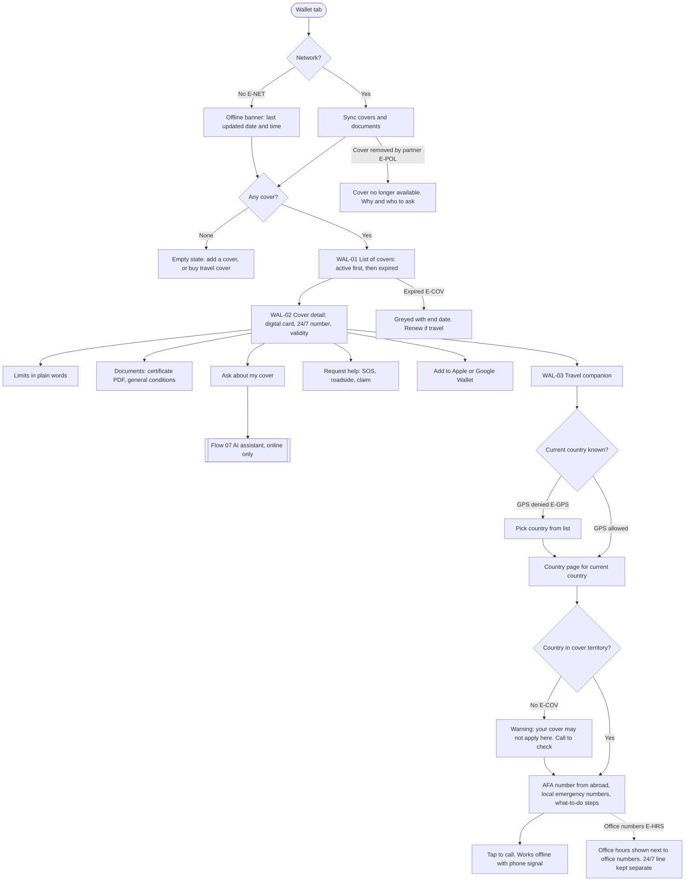

# 06 — Policy wallet and offline travel companion (MVP)

Status: DRAFT pitch input. Assumptions (A). Open questions (Q).
Roadmap features: **X2** policy wallet, **T3** travel companion basic, **X11** offline essentials, **T2** certificate in wallet [RM 2.1, 2.2, MVP item 5]. Entry to **AI1** (flow 07).

## Goal
A covered person can answer "am I covered, and who do I call?" in two taps, anywhere, with or without data.

## Entry points
- Wallet tab.
- Home: cover status card.
- Automatic switch to the offline view when there is no network (A).
- Pre-login: "Emergency numbers" on the welcome screen (numbers only, no cover data).
- Push before a trip: "Your travel pack is ready offline" (A).

## Preconditions
- Logged in with at least one linked cover (flow 01 or 04). Otherwise empty state.
- Offline pack downloaded at least once while online.
- Country content (numbers, steps) maintained by AFA (Q).

## Flow

## Step table
| # | Screen | User action | System response | AI involvement / human-in-the-loop | Notes (accessibility, FR/AR RTL) |
|---|---|---|---|---|---|
| 1 | Wallet tab | Opens | Syncs if online; else shows cached data with "last updated" | None | Offline banner announced once, not on every screen change |
| 2 | WAL-01 List | Picks a cover | Active covers first; partner covers labelled with partner name | None | Each card readable as text: product, holder, dates, status |
| 3 | WAL-02 Detail | Reads card | Digital card: name, policy number, validity, 24/7 number, QR | None | Card is real text, not an image. QR has the number as text. Policy number LTR in AR. Brightness boost when showing QR (A) |
| 4 | Limits | Reads | Limits in plain words from product wording | Plain-language texts written and approved by people, not generated live | Currency per product (fix mixed currencies [DR O-U5]) |
| 5 | Documents | Opens PDF, shares | Cached PDF opens offline | None | Tagged PDF **Q**. Share sheet native |
| 6 | Ask about my cover | Opens AI1 | Flow 07 (online only) | See flow 07 | Disabled offline with reason, not hidden |
| 7 | Add to Wallet pass | Taps | Generates pass (X2, Should) | None | Pass includes 24/7 number |
| 8 | WAL-03 Companion | Opens | Country from GPS or picked | None | Country list searchable in FR and AR |
| 9 | Country page | Reads, taps to call | Numbers and steps from the offline pack; territory check | None | Steps as numbered lists. Phone numbers as tap-to-call buttons with full number in text |
| 10 | Stale data | — | If last sync > 7 days, warn (A) | None | Warning text, not colour only |

## Edge states covered
E-NET (cached view), E-GPS (pick country), E-COV (expired cover, country outside territory), E-POL (cover removed after partner sync), E-HRS (office vs 24/7 numbers kept apart [DR O-U7]). E-OTP and E-PAY: not in this flow.

## Success criteria
- Info calls ("am I covered?", "what is the number?") per 1 000 active covers [RM 6, 5.5].
- Share of users with an offline pack before a trip.
- Wallet weekly opens (engagement).
- Zero cases where the offline 24/7 number is wrong (content QA).

## Open questions
- Q1. Policy data feeds from AFA and the pilot partner: real time or daily?
- Q2. Who writes and approves plain-language limits per product?
- Q3. Who maintains local emergency numbers per country, and how often?
- Q4. Is a digital card accepted by providers and hospitals as proof of cover?
- Q5. Apple/Google Wallet pass in MVP or V2?
