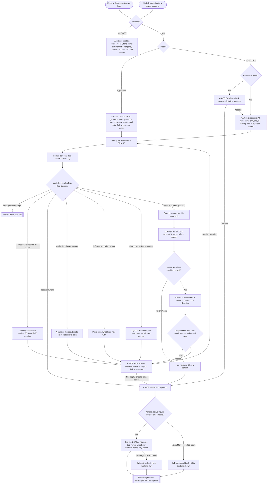

# 07 — AI cover assistant, FR/AR text (MVP Must pilot)

Status: DRAFT pitch input. Assumptions (A). Open questions (Q).
Roadmap features: **AI1** FR/AR cover assistant, **text only, cover and product questions only, hand-off to a human** [RM 3.2, RM 4.3 item 13]. Part of the decided AI lead with the agent copilot (flow 08). Darija voice is a V2 pilot (flow 09). Human chat **X5** is V2, so MVP hand-off = call or callback.

## Goal
Anyone gets a correct, sourced answer about AFA products in seconds, and a covered person gets "am I covered for X?" answered from their own contract, or reaches a person in one tap. Available 24/7.

## Two modes [RM 4.3]
| Mode | Who | Login | Sources | Not allowed |
|---|---|---|---|---|
| **(a) General product questions** | Anyone, e.g. a visa applicant before purchase (journey P1) | No | Published product wording and approved public FAQ only | Any personal data or contract lookup. "Is my own cover…?" → invites login (mode b) or a person |
| **(b) My cover** | Logged-in user with a linked cover | Yes | The user's own contract + product wording + approved FAQ | Answers about another person's cover |

## Entry points
- Mode (a): welcome screen "Ask a question" (flow 01); travel quote screen "Questions about these products?" (flow 04, neutral facts only, no recommendation).
- Mode (b): Wallet cover detail "Ask about my cover" (flow 06); Home "Questions about your cover?" (A); claim eligibility screen "Ask a question" (flow 05).
- **Not** from SOS, roadside or any emergency path.

## Preconditions
- Mode (b): logged in, at least one cover linked; separate consent to AI processing in the consent centre (X13) (A).
- Mode (a): no account data is used and input is redacted, so a disclosure is shown instead of a consent (A, **to confirm by legal counsel**).
- Data residency decided: where the model runs and what text leaves Morocco [RM 5.4]. **Blocking Q** (CNDP rules, to confirm by legal counsel).
- Content owner at AFA approves the source documents.
- The 24/7 line can take hand-offs at any hour (flow 02 Q1).

## Guardrails

### What it does
- Answers questions about the user's own cover: what is included, limits, territory, dates, how to declare, which documents.
- Quotes the source (product and section) for every answer.
- Says "I don't know" when the source does not answer.
- Hands off to a person at any time, and automatically in the cases below.

### What it must never do
| Never | Why | What happens instead |
|---|---|---|
| Give a medical diagnosis, medical advice or triage | Safety; health data rules under law 09-08 and CNDP (to confirm by legal counsel) [RM 3.1] | Stops. Shows SOS and the 24/7 number |
| Decide, promise or estimate a claim outcome or amount | Claims are decided by a handler [RM 3.1] | Explains the claim steps; links to claim status |
| Recommend or sell a product (both modes) | ACAPS duty of advice and misleading offers (to confirm by legal counsel) [RM AI8] | Links to the quote screen with neutral facts |
| Handle an emergency | Humans only on emergency, medical, funeral [RM AI1] | SOS and 24/7 call shown at once |
| Answer about another person's cover, or about any contract in mode (a) | Privacy; family X8 is V2 | Asks the person to log in with their own account, or offers a person |
| Invent numbers, limits or phone numbers not in the source | Wrong cover answers = consumer and ACAPS risk | Says it does not know; offers a person |
| Change policy, personal or payment data | Not a transaction channel | Points to the right screen or a person |
| Ask for card numbers, passwords or OTP codes | Fraud risk | Warns the user never to share them |
| Talk about death or funeral beyond giving the human route | F1 rule: no AI front line [RM 2.6] | Hands off to a person at once |

## Flow

## Step table
| # | Screen | User action | System response | AI involvement / human-in-the-loop | Notes (accessibility, FR/AR RTL) |
|---|---|---|---|---|---|
| 1 | AIA-00 Consent (mode b) / AIA-01a disclosure (mode a) | Accepts or declines | Records consent; declining routes to a person. Mode (a) shows a disclosure only (to confirm by legal counsel) | None | Consent text short, with "learn more". Declining has no penalty |
| 2 | AIA-01 Disclosure | Reads | Shows scope, limits, person button | Clear AI label on every answer (A) | Disclosure read by screen reader before the input field |
| 3 | Input | Types FR or AR (Darija in Latin or Arabic script: best effort, not promised) | Redacts names, numbers, health words before processing (A) [RM 5.4 option c] | AI | Input supports RTL and mixed scripts. Voice input of the OS keyboard is allowed; Darija voice assistant is V2 |
| 4 | Input check | — | Classifier routes: emergency, medical, funeral, claim decision, off topic, cover question | **AI classifier + keyword rules.** Emergency and medical rules are deterministic backstops, not only the model | False negatives on emergency are the top risk: tune for recall |
| 5 | Retrieval | — | Mode (a): published product wording + approved FAQ. Mode (b): + the user's own contract. E-LOAD "Looking it up", timeout 10 s (A) → offer a person | AI (retrieval). Sources owned by an AFA content owner | Loading status announced (4.1.3) |
| 6 | Answer | Reads | Answer + quoted source + "information, not a decision" | AI generates. **Output check** compares numbers to source and blocks banned topics | Answer in the language of the question. FR terms inside AR answers isolated for bidi. Short sentences |
| 7 | AIA-02 Feedback | Optionally rates (skippable), or asks for a person | Logs rating | **Weekly human review** of a sample of answers + all "not helpful" (A) [RM 6 AI quality] | Buttons labelled, not icons only |
| 8 | AIA-03 Hand-off | Calls, or requests a callback | Abroad (device country or roaming, A), active trip (travel cover dates include today) or outside office hours → **24/7 line, one tap**; next-day callback only as an optional extra for non-urgent questions. In Morocco in office hours → call or callback. Request carries transcript (if the user agrees) and cover ID (mode b) | **Human agent takes over** (flow 08). Agent sees what the AI said | Person button is always visible, never hidden behind the chat |

## Edge states covered
E-NET (offline summary or numbers, 24/7 call), E-LOAD (lookup timeout → person), E-HRS (abroad, active trip or night → 24/7 line; callback only in Morocco in office hours or as an optional extra), E-POL (no linked cover → mode (a) only; add a cover for mode (b)), E-COV (answer says "not covered per section X" with source; final word by a person on request). E-GPS, E-OTP, E-PAY: not in this flow.

## Success criteria
- Share of questions answered without hand-off **and** rated correct in human review [RM 6].
- Zero answers in banned categories (audit of all flagged + random sample).
- Emergency recall: all emergency test prompts routed to SOS (red-team set in FR and AR before launch).
- Info calls per 1 000 active covers (deflection of information calls only, never emergencies) [RM 5.5].

## Open questions
- Q1. Where does the model run, and what may leave Morocco? (CNDP) [RM 5.4]
- Q2. Who at AFA owns and approves source content and answer reviews?
- Q3. Is a written answer about cover legally binding? Disclaimer wording (to confirm by legal counsel).
- Q7. Is a disclosure enough for mode (a), with no consent step? (to confirm by legal counsel)
- Q4. Callback hours and team for non-urgent hand-offs; capacity of the 24/7 line for assistant hand-offs.
- Q5. Retention of transcripts.
- Q6. Should the pilot run with a small group first (e.g. direct travel clients only)?

## Changelog 2026-11-18 (critic fixes)
- Finding 11a: mode (a) general product questions before login, grounded only in published product wording and FAQ; mode (b) my cover after login [RM 4.3 item 13].
- Finding 11b: abroad, active-trip and night users are handed to the 24/7 line, never only a next-day callback. Available 24/7.
- "What it must never do" list kept, extended to mode (a).
- Finding 12: E-LOAD with timeout on lookup; guardrail answers no longer dead ends.
- Finding 7: law 09-08, CNDP and ACAPS statements marked "to confirm by legal counsel".
