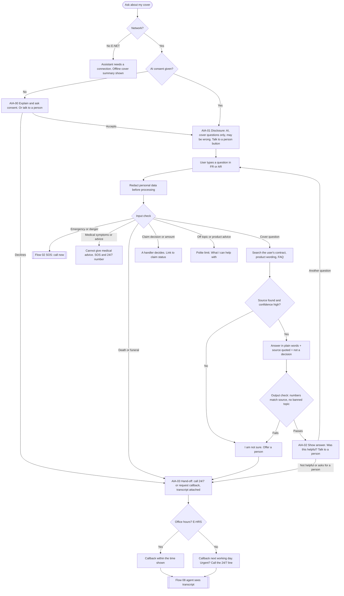

# 07 — AI cover assistant, FR/AR text (MVP pilot)

Status: DRAFT pitch input. Assumptions (A). Open questions (Q).
Roadmap features: **AI1** multilingual assistant, **text only, FR and AR, cover questions only, hand-off to a human** [RM 3.2, MVP item 13]. Darija voice is a V2 pilot (flow 09). Human chat **X5** is V2, so MVP hand-off = call or callback.

## Goal
A covered person gets a correct, sourced answer to "am I covered for X?" from their own contract in seconds, or reaches a person in one tap.

## Entry points
- Wallet cover detail: "Ask about my cover" (flow 06).
- Home: "Questions about your cover?" (A).
- Claim flow eligibility screen: "Ask a question" (flow 05).
- **Not** from SOS, roadside or any emergency path.

## Preconditions
- Logged in, at least one cover linked. Answers are grounded only in that user's contract, product wording and approved FAQ.
- Separate consent to AI processing in the consent centre (X13) (A).
- Data residency option decided: where the model runs and what text leaves Morocco [RM 5.4]. **Blocking Q.**
- Content owner at AFA approves the source documents.

## Guardrails

### What it does
- Answers questions about the user's own cover: what is included, limits, territory, dates, how to declare, which documents.
- Quotes the source (product and section) for every answer.
- Says "I don't know" when the source does not answer.
- Hands off to a person at any time, and automatically in the cases below.

### What it must never do
| Never | Why | What happens instead |
|---|---|---|
| Give a medical diagnosis, medical advice or triage | Health data (09-08, CNDP); safety [RM 3.1] | Stops. Shows SOS and the 24/7 number |
| Decide, promise or estimate a claim outcome or amount | Claims are decided by a handler [RM 3.1] | Explains the claim steps; links to claim status |
| Recommend or sell a product | ACAPS duty of advice and misleading offers [RM AI8] | Links to the quote screen with neutral facts |
| Handle an emergency | Humans only on emergency, medical, funeral [RM AI1] | SOS and 24/7 call shown at once |
| Answer about another person's cover | Privacy; family X8 is V2 | Asks the person to use their own account |
| Invent numbers, limits or phone numbers not in the source | Wrong cover answers = consumer and ACAPS risk | Says it does not know; offers a person |
| Change policy, personal or payment data | Not a transaction channel | Points to the right screen or a person |
| Ask for card numbers, passwords or OTP codes | Fraud risk | Warns the user never to share them |
| Talk about death or funeral beyond giving the human route | F1 rule: no AI front line [RM 2.6] | Hands off to a person at once |

## Flow

## Step table
| # | Screen | User action | System response | AI involvement / human-in-the-loop | Notes (accessibility, FR/AR RTL) |
|---|---|---|---|---|---|
| 1 | AIA-00 Consent | Accepts or declines | Records consent; declining routes to a person | None | Consent text short, with "learn more". Declining has no penalty |
| 2 | AIA-01 Disclosure | Reads | Shows scope, limits, person button | Clear AI label on every answer (A) | Disclosure read by screen reader before the input field |
| 3 | Input | Types FR or AR (Darija in Latin or Arabic script: best effort, not promised) | Redacts names, numbers, health words before processing (A) [RM 5.4 option c] | AI | Input supports RTL and mixed scripts. Voice input of the OS keyboard is allowed; Darija voice assistant is V2 |
| 4 | Input check | — | Classifier routes: emergency, medical, funeral, claim decision, off topic, cover question | **AI classifier + keyword rules.** Emergency and medical rules are deterministic backstops, not only the model | False negatives on emergency are the top risk: tune for recall |
| 5 | Retrieval | — | Finds passages in the user's contract and approved FAQ | AI (retrieval). Sources owned by an AFA content owner | — |
| 6 | Answer | Reads | Answer + quoted source + "information, not a decision" | AI generates. **Output check** compares numbers to source and blocks banned topics | Answer in the language of the question. FR terms inside AR answers isolated for bidi. Short sentences |
| 7 | AIA-02 Feedback | Rates or asks for a person | Logs rating | **Weekly human review** of a sample of answers + all "not helpful" (A) [RM 6 AI quality] | Buttons labelled, not icons only |
| 8 | AIA-03 Hand-off | Calls or requests callback | Creates a request with transcript and cover ID | **Human agent takes over** (flow 08). Agent sees what the AI said | Person button is always visible, never hidden behind the chat |

## Edge states covered
E-NET (offline summary), E-HRS (callback time shown; 24/7 line for urgent), E-POL (no linked cover → assistant not offered; add cover first), E-COV (answer says "not covered per section X" with source; final word by a person on request). E-GPS, E-OTP, E-PAY: not in this flow.

## Success criteria
- Share of questions answered without hand-off **and** rated correct in human review [RM 6].
- Zero answers in banned categories (audit of all flagged + random sample).
- Emergency recall: all emergency test prompts routed to SOS (red-team set in FR and AR before launch).
- Info calls per 1 000 active covers (deflection of information calls only, never emergencies) [RM 5.5].

## Open questions
- Q1. Where does the model run, and what may leave Morocco? (CNDP) [RM 5.4]
- Q2. Who at AFA owns and approves source content and answer reviews?
- Q3. Is a written answer about cover legally binding? Disclaimer wording from legal.
- Q4. Callback hours and team for hand-offs.
- Q5. Retention of transcripts.
- Q6. Should the pilot run with a small group first (e.g. direct travel clients only)?
