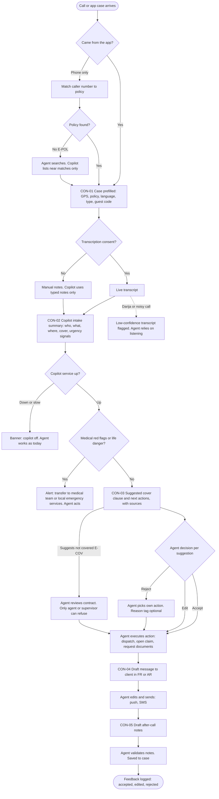

# 08 — Call-centre agent copilot, backstage (MVP pilot)

Status: DRAFT pitch input. Assumptions (A). Open questions (Q).
Roadmap features: **AI9** agent copilot, **pilot with one team** (summaries + after-call notes first) [RM 3.2, MVP item 12]. Receives cases from flows 02, 03, 05, 07.
Users: AFA call-centre agents (+300 staff [REC A4]) and their supervisor. Not a client-facing flow.

## Goal
An agent understands a case in seconds, picks the right next action faster, and writes less, while every decision stays with the agent.

## Entry points
- Inbound phone call (with or without app).
- App SOS case (flow 02), roadside request (flow 03), travel claim (flow 05) for claim handlers.
- Hand-off from the AI cover assistant with transcript (flow 07).
- Callback queue.

## Preconditions
- Copilot integrated with the case system and telephony (Q [RM 7.2 Q4]).
- Call recording and transcription consent: IVR message at call start (A; legal Q).
- Hosting decided for audio and text (CNDP) [RM 5.4].
- Pilot team trained; supervisor reviews a sample.

## What the copilot must never do
- Speak or write to the client directly. Every message is sent by the agent.
- Dispatch a provider, accept or refuse cover, or approve a payment by itself.
- Give medical triage. Medical red flags route to AFA's medical team (human).
- Hide its sources. Each suggestion shows the clause or case data it uses.

## Flow

## Step table
| # | Screen | Agent action | System response | AI involvement / human-in-the-loop | Notes (accessibility, FR/AR RTL) |
|---|---|---|---|---|---|
| 1 | CON-01 Case | Answers call; reads prefilled case | App data or caller-number match | None, or near-match list (AI) when no policy found. Agent chooses | Console keyboard-first. FR and AR UI for agents (A) |
| 2 | Transcript | Talks to client | Live transcript if consent | AI speech-to-text. Darija quality unproven: confidence shown per segment [RM AI1] | Transcript in source language; optional FR translation for the agent (A) |
| 3 | CON-02 Summary | Reads, corrects | Summary with source links to transcript lines | AI summary. **Agent corrects before it is saved** | Summary as fields, not free prose |
| 4 | Red-flag check | Transfers if needed | Alert banner | AI + keyword rules. **Medical team decides** | Alert uses text + icon, not colour only |
| 5 | CON-03 Suggestions | Accepts, edits, rejects each | Clause and action suggestions with sources | AI suggests. **Agent decides and executes.** Refusal of cover only by a person | One-key accept/reject shortcuts. Never pre-executed |
| 6 | CON-04 Message draft | Edits and sends | Draft in client's language | AI drafts. **Agent sends** | AR drafts checked for RTL and mixed numbers |
| 7 | CON-05 Notes | Validates | Notes saved to case | AI drafts. **Agent validates** | — |
| 8 | Feedback | — | Accept / edit / reject logged | Supervisor reviews a weekly sample (A) | Feeds AI quality metric [RM 6] |

## Edge states covered
E-POL (no match), E-COV (copilot may flag, only a person refuses), copilot down (manual mode), low-confidence transcript (Darija, noise), no consent (manual), medical red flags (human medical team). E-GPS: app case without GPS → summary shows "location missing, ask". E-HRS: night shift uses the same console (A); fewer agents means summaries matter more. E-NET, E-OTP, E-PAY: client-side, not in this flow.

## Success criteria
- Average handle time change, pilot team vs control [RM 6 AI9].
- Agent acceptance rate of suggestions and summaries.
- After-call work time per case.
- Zero actions executed without an agent click (audit log).
- Agent satisfaction with the tool (pilot survey).

## Open questions
- Q1. Case system and telephony vendors, and their APIs?
- Q2. Is call recording in place, with consent wording? [RM 7.2 Q12]
- Q3. Which team pilots: roadside, travel or claims?
- Q4. Where do audio and transcripts live (CNDP)? [RM 5.4]
- Q5. Language mix of calls (FR, AR, Darija, other) to size the transcription risk.
