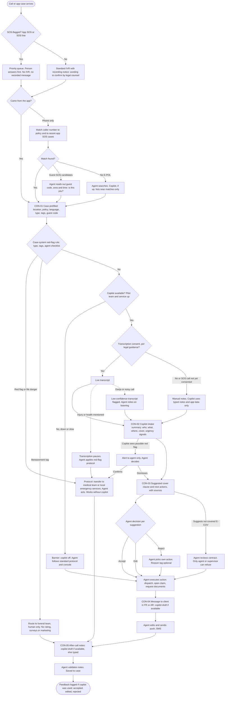

# 08 — Agent console, red-flag rule and copilot, backstage (MVP Must pilot)

Status: DRAFT pitch input. Assumptions (A). Open questions (Q).
Roadmap features: **AI9** agent copilot, **pilot with one team** (summaries + after-call notes first; proposed pilot team: **roadside non-injury**) [RM 4.3 item 12]. **API1** engine and case system (MVP Must). Receives cases from flows 02, 03, 05, 07. Part of the decided AI lead with the cover assistant (flow 07).
Users: AFA call-centre agents (AFA has +300 staff in total [REC A4]; the number of agents is unknown) and their supervisor. Not a client-facing flow.

## Goal
An agent understands a case in seconds, picks the right next action faster, and writes less, while every decision stays with the agent.

## Entry points
- Inbound phone call (with or without app).
- App SOS case (flow 02), roadside request (flow 03), travel claim (flow 05) for claim handlers.
- Hand-off from the AI cover assistant with transcript (flow 07).
- Callback queue.

## Preconditions
- Copilot integrated with the case system and telephony (Q [RM 7.2 Q4]).
- **Emergency calls are answered by a person first.** SOS-flagged calls (app SOS, SOS line) skip the IVR and any recorded notice. How recording and transcription consent is handled on those calls (e.g. agent informs once the person is safe, or no recording) is **to confirm by legal counsel**. Non-SOS calls: recorded notice in the IVR (A, wording to confirm by legal counsel).
- Hosting decided for audio and text (CNDP rules, to confirm by legal counsel) [RM 5.4].
- **Medical red-flag rule lives in the case system** (case type, reason tags, agent checklist) and the agent protocol. It runs whether the copilot is up, down or not in the pilot.
- Pilot team trained; supervisor reviews a sample.

## What the copilot must never do
- Speak or write to the client directly. Every message is sent by the agent.
- Dispatch a provider, accept or refuse cover, or approve a payment by itself.
- Give medical triage. Medical red flags route to AFA's medical team (human) through the case-system rule; the copilot can only add an alert.
- Hide its sources. Each suggestion shows the clause or case data it uses.

## Flow

## Step table
| # | Screen | Agent action | System response | AI involvement / human-in-the-loop | Notes (accessibility, FR/AR RTL) |
|---|---|---|---|---|---|
| 1 | CON-01 Case | Answers call (SOS calls: first, with no IVR); reads prefilled case | App data, caller-number match, or guest code read out by the agent | None, or near-match list (AI) when no policy found. Agent chooses | Console keyboard-first. FR and AR UI for agents (A) |
| 2 | Transcript | Talks to client | Live transcript if consent (per legal guidance, to confirm). Pauses when injury or health is mentioned (proposed pilot rule) | AI speech-to-text. Darija quality unproven: confidence shown per segment [RM AI1] | Transcript in source language; optional FR translation for the agent (A) |
| 3 | CON-02 Summary | Reads, corrects | Summary with source links to transcript lines | AI summary. **Agent corrects before it is saved** | Summary as fields, not free prose |
| 4 | Red-flag rule | Transfers if needed | **Case-system rule** on type, tags and agent checklist, always on. Copilot may add an alert | Rules + agent protocol; copilot only alerts. **Medical team decides** | Alert uses text + icon, not colour only |
| 5 | CON-03 Suggestions | Accepts, edits, rejects each | Clause and action suggestions with sources | AI suggests. **Agent decides and executes.** Refusal of cover only by a person | One-key accept/reject shortcuts. Never pre-executed |
| 6 | CON-04 Message draft | Edits and sends | Draft in client's language | AI drafts. **Agent sends** | AR drafts checked for RTL and mixed numbers |
| 7 | CON-05 Notes | Validates | Notes saved to case | AI drafts. **Agent validates** | — |
| 8 | Feedback | — | Accept / edit / reject logged | Supervisor reviews a weekly sample (A) | Feeds AI quality metric [RM 6] |

## Edge states covered
SOS calls (person first, no IVR), guest match (code read out), E-POL (no match), E-COV (copilot may flag, only a person refuses), copilot down or team not in pilot (standard protocol, continues to action and notes), red flags (case-system rule, independent of copilot), bereavement (funeral team, no rating), low-confidence transcript (Darija, noise), no consent (manual), medical red flags (human medical team). E-GPS: app case without GPS → summary shows "location missing, ask". E-HRS: night shift uses the same console (A); fewer agents means summaries matter more. E-NET, E-OTP, E-PAY: client-side, not in this flow.

## Success criteria
- Average handle time change, pilot team vs control [RM 6 AI9].
- Agent acceptance rate of suggestions and summaries.
- After-call work time per case.
- Zero actions executed without an agent click (audit log).
- Zero SOS calls with a recorded message before the agent (telephony log).
- Red-flag transfers happen at the same rate with the copilot up or down (rule works alone).
- Agent satisfaction with the tool (pilot survey).

## Open questions
- Q1. Case system and telephony vendors, and their APIs?
- Q2. Is call recording in place, with consent wording? How is consent handled on SOS calls? (to confirm by legal counsel)
- Q3. Pilot team: proposed roadside non-injury [RM 4.3 item 12]. To confirm with AFA operations.
- Q4. Where do audio and transcripts live (CNDP)? [RM 5.4]
- Q5. Language mix of calls (FR, AR, Darija, other) to size the transcription risk.

## Changelog 2026-11-18 (critic fixes)
- Finding 2: SOS-flagged calls are answered by a person first; no IVR or recording message before the agent. Consent on those calls marked "to confirm by legal counsel".
- Finding 11c: medical red-flag routing is a case-system rule and agent protocol, independent of the copilot; the copilot only adds alerts.
- Finding 12: dead end "copilot off" now continues to the agent's action, message and notes.
- Finding 8: proposed pilot team roadside non-injury; transcription pauses when injury or health is mentioned.
- Finding 9: bereavement tag routes to the funeral team, no rating.
- Finding 6: "+300 staff" labelled as total AFA staff, not agents.
- Finding 7: legal statements marked "to confirm by legal counsel".
