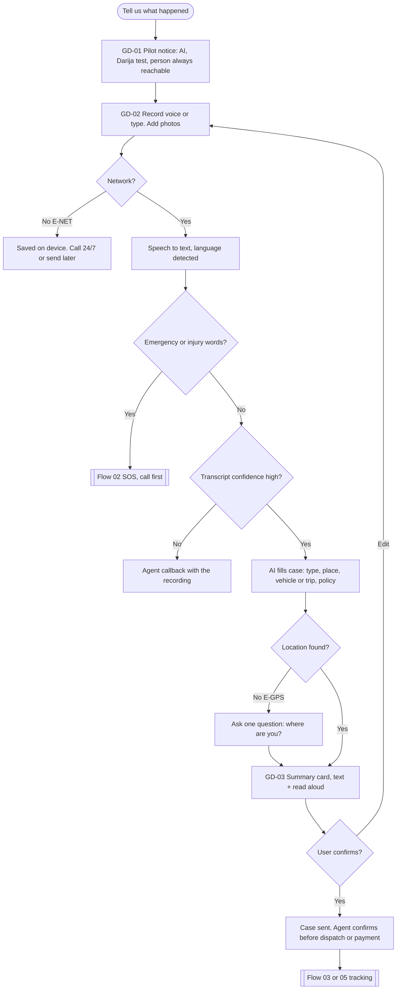

# 09 — Guided incident declaration by voice and photo, Darija pilot (**V2 sketch**)

Status: **V2. Not in MVP.** Sketch only. DRAFT pitch input. Assumptions (A). Open questions (Q).
Roadmap features: **AI2** AI-guided incident declaration, **AI1-voice** Darija voice pilot [RM 3.2, 4.4 V2]. Applies to non-emergency requests: roadside (R1), home (H1, V2), travel claims (T7).
Prerequisites from the roadmap: clean case API from MVP, Darija speech-to-text tested, Wizard-of-Oz test with users before any build [RM 7.3].

## Goal
A person describes what happened in their own words, in Darija, French or Arabic, adds photos, and gets a structured case to confirm, without filling a form.

## Entry points
- Help tab: "Tell us what happened" (voice or photo).
- Roadside and claim flows: "Describe by voice instead".
- Not from SOS. Emergencies always go to a person, call first (flow 02).

## Flow

## Step table (short)
| # | Screen | User action | System response | AI involvement / human-in-the-loop | Notes |
|---|---|---|---|---|---|
| 1 | GD-01 Notice | Reads | Pilot label, consent for voice data | — | Voice and photos are personal data under law 09-08 (to confirm by legal counsel) |
| 2 | GD-02 Capture | Speaks, types, adds photos | Records; on-device where possible (A) | — | Text input always available (deaf, noisy places). Large record button with label |
| 3 | Transcription | — | Speech to text in Darija / FR / AR | AI. Low confidence → human callback | Darija quality is the main risk; no benchmark source [BM 4c] |
| 4 | Structuring | — | Fills case fields | **AI2.** Fields marked "filled by AI" | — |
| 5 | GD-03 Summary | Confirms or edits | Summary in text and audio, in the user's language | **User confirms**, then **agent confirms** before dispatch or payment | Audio summary helps low-literacy users (A) |
| 6 | Pilot review | — | 100% of pilot cases reviewed by a person at start (A) | Human review | Decide scale-up only on measured accuracy |

## Edge states
E-NET (saved, call), E-GPS (one question), low-confidence transcript (callback), emergency words (SOS), E-COV and E-POL handled by the agent at confirmation as in flows 03 and 05.

## Success criteria (pilot)
- Field accuracy vs agent-corrected case. Threshold set before the pilot.
- Time to a complete case vs form flow.
- Share of users who choose voice over form, by language.

## Open questions
- Q1. Darija speech models: which vendor, where hosted (CNDP)? [RM 5.4]
- Q2. Consent to use pilot recordings to improve the model?
- Q3. Which line pilots first: roadside or travel claims?

## Changelog 2026-11-18 (critic fixes)
- Finding 7: law 09-08 statement marked "to confirm by legal counsel".
- Finding 2: SOS links point to the call-first flow 02. Still V2 per RM 4.3 (AI2 and Darija voice).
