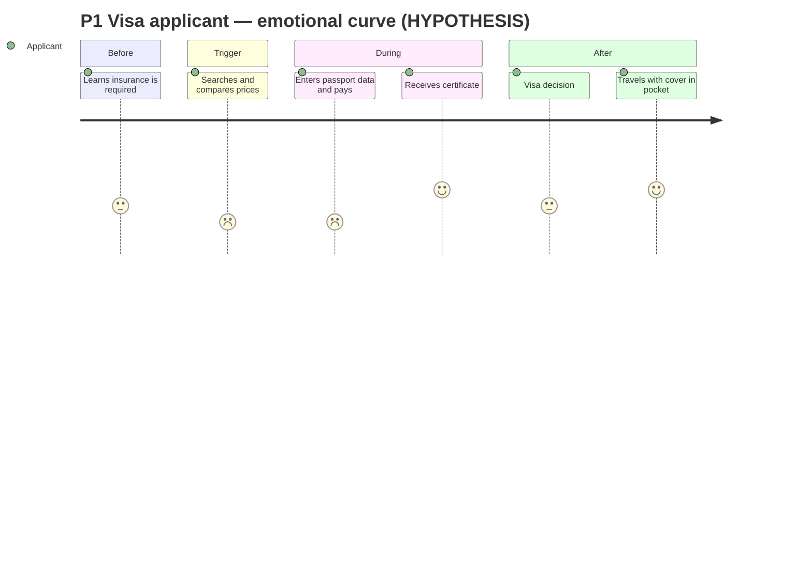
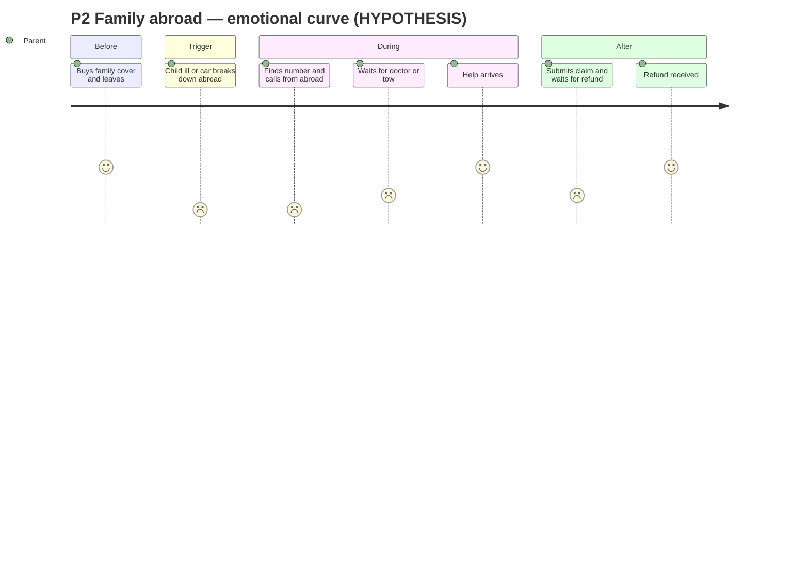
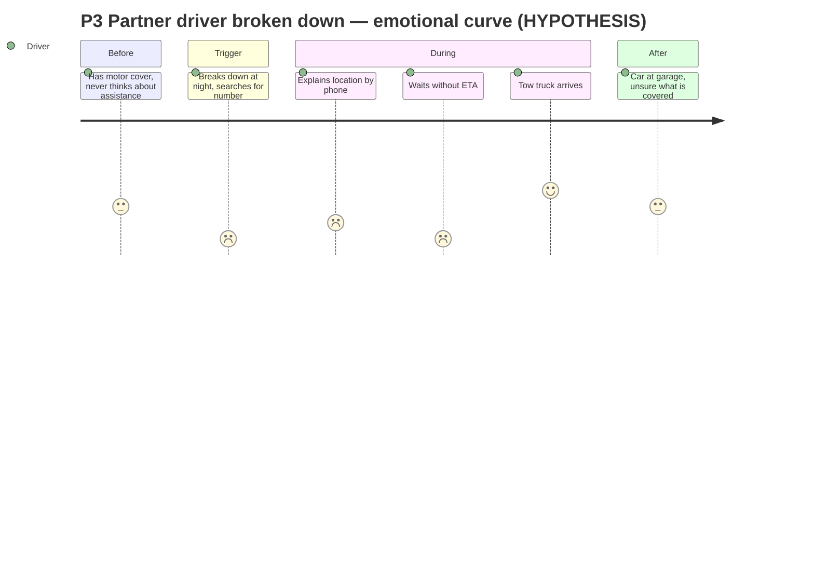
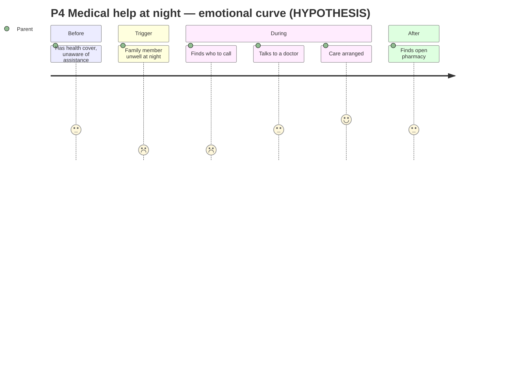
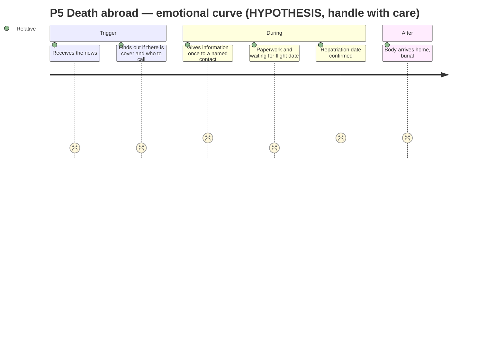

# UX journey maps, proto-personas and SOS service blueprint (pitch input)

Date: 2026-11-18
Author: research
Status: **DRAFT for the studio lead. HYPOTHESES, not findings.** No user research has been done on this project. Nothing here says what AFA's clients actually feel, need or do.
Purpose: give the pitch package journey maps that show *where* the app (MVP, V2, V3, AI layer) would help, and *what* we must validate first.
Not touched: `brief.md`, `decisions.md`, `personas.md` (evidence-only), `status.md`. Gate 1 (problem framing) still applies before any UI work.

## How to read this file

| Key | File | Nature |
|---|---|---|
| [REC] | `studio/research/2026-11-18-recognition-afa.md` | Desk research on AFA. Mostly search snippets. Not user evidence. |
| [BM] | `studio/research/2026-11-18-benchmark-apps.md` | Desk benchmark. Company claims. App IDs N1–N10, A1–A13, I1–I18. Not user evidence. |
| [DR] | `studio/research/2026-11-17-desk-review-current-site.md` | Desk review of AFA's website (facts A*, usability O-U*, contradictions O-C*, accessibility A-*). |
| [RM] | `studio/strategy/2026-11-18-app-features-mvp-roadmap.md` | Feature IDs (X*, T*, M*, R*, H*, F*, B*), AI IDs (AI1–AI9), MVP/V2/V3 split, moments M1–M6. |
| [DEC] | `studio/decisions.md` | Studio lead decisions. |

Labels used:
- **(H)** = hypothesis. Every thought, emotion and need below is (H). They come from desk evidence and reasoning, not from users.
- **Said / did:** there is no "said" or "did" data yet. Where a cell describes a behaviour, it is an *assumed* behaviour.
- **Pain points today** cite a desk source when one exists. A pain point with no citation is a reasoned assumption and is marked "(A, no source)".
- **No quotes.** No participant IDs. None exist.
- **Flows:** screen-level flows are being written by another agent in `studio/design/flows/`. References below use "see flows/<name>". **The names are provisional** and must be reconciled with the files when they are published.
- **Emotion curves** use a 1–5 scale in the mermaid diagrams (1 = very negative, 5 = very positive) plus a plain text row. All values are (H).

---

## 1. Summary

1. **Five proto-personas, all HYPOTHESES TO VALIDATE:** P1 visa applicant (Isaaf Visa Europe), P2 family travelling abroad in summer (Isaaf Monde, with an MRE variant), P3 partner motor-policy holder broken down on the road (Sanlam Maroc beneficiary), P4 health-plan member needing medical help at night (La Marocaine Vie "Sehha" beneficiary), P5 relative handling a death abroad (funeral repatriation).
2. **The low point of every journey is the same (H): the first minutes after the trigger,** when the person must find the right number, explain who and where they are, and then wait without knowing what happens. This matches roadmap moment M1 [RM 1.3] and the desk evidence: phone-only help, confusing emergency numbers [DR O-U7, O-C1], no case tracking [DR O-U9].
3. **The MVP covers the low point for P1, P2 and P3, and only partly for P4 and P5.** Medical request (M1), teleconsultation (M2), funeral flow (F1) and family/act-for-someone (X8) are V2 [RM 4.3, 4.4]. P4 and P5 rely on SOS + phone + case tracking in the MVP.
4. **Three journeys depend on acting for someone else** (a child, a parent, a deceased relative). X8 family is V2. Flagged for a decision (section 9).
5. **P3 (partner beneficiary) may never install the app.** In that journey the biggest MVP lever is the agent copilot (AI9) and SMS updates (X7), not the app screens [RM 3.3]. The blueprint (section 7) is built to work with or without the app.
6. **Language and accessibility matter most at the low point:** Darija is daily speech for 91.9% [REC A8, S90]; the current site is French only [DR A5]. Stress, night, roadside noise, small screens and older users make WCAG 2.2 AA points (target size, text scaling, no time limits, accessible authentication, screen-reader order in RTL) critical, not cosmetic.
7. **Biggest risks to these journeys (section 8):** AFA's right to reach partner beneficiaries [REC C1]; whether people in an incident open an app at all rather than call; whether beneficiaries recognise the AFA brand [REC O2]; whether visa buyers will buy in-app rather than at an agency with cash [REC S73, S74].

---

## 2. Proto-personas — HYPOTHESES TO VALIDATE

> **HYPOTHESES TO VALIDATE.** These are proto-personas built from desk evidence (market data, product terms, benchmark). They are **not** research personas. They have no participants behind them. Do not copy them into `studio/personas.md`, which is evidence-only. Replace them with evidence-based personas after the research in section 8.
>
> Names are archetype labels, not people. No age, income or quote is given because none is known.

### P1 — "The visa applicant" (direct Isaaf client, segment S1)

| | |
|---|---|
| **Who (H)** | A Morocco resident applying for a Schengen visa (tourism, family visit, business). Needs travel insurance as a document for the visa file. |
| **Desk evidence** | About 606 000 Schengen visas granted to Moroccans in 2024; refusal about 20%; Moroccans 4th largest applicant nationality [REC A8, S80, S81]. Isaaf Visa Europe from 450 dhs, insured must be "domicilié au Maroc" [DR A3]. AFA promises an immediate certificate "conforme aux directives consulaires" [DR A4]. Sold online, at agencies/brokers and by phone [DR A6]. Card or m-wallet use is low; cash dominant [REC S73, S74]. |
| **Relation to AFA** | AFA's own customer. Knows the "Isaaf" or AFA name at least at purchase (H). |
| **Main job (H)** | Get an insurance certificate the consulate accepts, quickly, at a clear price, without a mistake in names or dates. |
| **Needs (H)** | Full price before paying; certainty the cover meets the 30 000 € Schengen rule; certificate in the language the consulate needs; a way to fix errors; the certificate easy to print or forward. |
| **Language (H)** | Reads French or Arabic for documents; certificate likely needed in French or another consulate language [DR A4: languages "not stated"]. |
| **Channels (H)** | Agency or broker (possibly paying cash), website, phone. WhatsApp to forward documents (A, no source). |
| **Unknowns** | Share buying online vs agency [DR C]; who fills the form (applicant, travel agent, visa service) (A); whether certificate errors happen and how often (Q). |

### P2 — "The family on the summer trip" (direct Isaaf client, segment S1; MRE variant)

| | |
|---|---|
| **Who (H)** | A Morocco-resident family travelling abroad in summer, often by car and ferry, with children and possibly grandparents. **Variant (H):** a Moroccan resident abroad (MRE) family returning to Morocco for the summer. |
| **Desk evidence** | Isaaf Monde is a family cover (spouse, children under 21, optional ascendants), includes vehicle assistance in Morocco and abroad for a Morocco-registered car [DR A3]. 4.06 M MRE entered Morocco in summer 2025 (Opération Marhaba), 54% by port [REC A8, S83]. Destinations: Spain 25%, France 25% [REC S84]. Peak season load [RM 5.8]. |
| **Eligibility flag** | Isaaf travel products require residence in Morocco and a Morocco-registered vehicle [DR A3, A5]. **An MRE family living abroad may not be eligible for any Isaaf retail product.** MRE may reach AFA only through a partner contract (e.g. a Moroccan motor policy, a bank card) (A). **Ask the client before treating MRE as a direct segment.** |
| **Main job (H)** | Travel with the whole family and know that if someone gets ill or the car breaks down abroad, help comes, in a language they understand, without paying large sums upfront. |
| **Needs (H)** | Cover and numbers available offline and without roaming data; one place for all family members; help in Darija/Arabic/French while abroad; simple reimbursement afterwards. |
| **Channels (H)** | Phone (roaming cost a concern, A), WhatsApp, possibly the app. |
| **Unknowns** | Whether families keep the certificate or call number with them on the road (A); who in the family handles the incident (A). |

### P3 — "The driver who does not know AFA" (partner beneficiary, segment S2)

| | |
|---|---|
| **Who (H)** | A Sanlam Maroc (now SanlamAllianz Maroc) motor-policy holder whose car breaks down or is in an accident on the road. Assistance comes from AFA under the insurer's contract. |
| **Desk evidence** | AFA is the "Assisteur" in Sanlam Maroc motor general conditions; also in Assur'Auto Green+ (EV/hybrid) [REC S20, S21]. AFA is Sanlam Maroc's "historic and exclusive" assistance partner [REC S16]. Most of the "8 M beneficiaries" are probably partner end-users who may not know the AFA brand [REC O1, O2]. Sanlam Maroc already has an app (claims tracking, fingerprint login) [BM N6]. No Moroccan app found with geolocated SOS or tow-truck tracking [BM 1.2]. |
| **Relation to AFA** | Not AFA's customer. Holds the insurer's contract. May think "Sanlam" is helping (H, [REC O2] low confidence). |
| **Main job (H)** | Get the car and the people in it safe and moving again, fast, at any hour, without having to explain where they are. |
| **Needs (H)** | Find the right number in seconds; be located without describing the road; know who is coming and when; know what happens to the car and to the trip (R4). |
| **Language (H)** | Darija speech most likely for the call [REC S90]; reading in Arabic or French. Roadside noise makes voice hard (A). |
| **Channels (H)** | Phone (number on the insurance card or attestation, A), insurer's app, insurer's agent, WhatsApp. **The AFA app may not be installed.** |
| **Unknowns** | Whether AFA may contact these beneficiaries or offer them an app [REC C1, D4 Q2]; where the assistance number is printed today (Q). |

### P4 — "The parent at night with a sick family member" (partner health-plan beneficiary, segment S2)

| | |
|---|---|
| **Who (H)** | A member of La Marocaine Vie's "Sehha" health offer, which includes AFA medical assistance, who needs medical advice or a doctor at night for a child or an older parent. **Variant (H):** a foreign resident in Morocco with Isaaf Résidents Étrangers (direct client, French/English). |
| **Desk evidence** | La Marocaine Vie × AFA partnership (May 2022) adds medical assistance to Sehha [REC S22, S23]. Isaaf Résidents Étrangers au Maroc exists [DR A2]. Insurer apps show telehealth (MyRMA Allô Santé, MyAXA e-health) [BM N4, N5]; teleconsultation with prescriptions is a pattern in Africa and international apps [BM A1, A7, I3]. Health data: law 09-08, CNDP authorisation, no transfer abroad without approval [REC S100–S102]. |
| **Relation to AFA** | Not AFA's customer (Sehha variant). May not know AFA exists (H). |
| **Main job (H)** | Decide quickly how serious it is, and get the right care (advice, doctor visit, ambulance) without guessing. |
| **Needs (H)** | A human medical voice fast; clear next step; know what the plan pays; prescription and pharmacy on duty; act on behalf of a child or parent. |
| **Language (H)** | Darija/Arabic for most; French/English for foreign residents. Medical terms are a barrier (A). |
| **Channels (H)** | Phone, insurer contact, family doctor, emergency services. AFA app unlikely to be installed unless the partner promotes it (A). |
| **Unknowns** | What Sehha's assistance actually includes (Q); whether AFA runs a medical triage team 24/7 [RM M1 "medical team triage process"] (Q). |

### P5 — "The relative handling a death abroad" (funeral / body repatriation; handle with care)

| | |
|---|---|
| **Who (H)** | An adult family member in Morocco (or abroad) who learns that a relative has died while travelling. The deceased held cover that includes transport of the body to Morocco. The relative is **not** the policyholder. |
| **Desk evidence** | Isaaf Visa Europe includes "body transport to Morocco" [DR A3]; AFA sells "Assistance Décès" [DR A2]. Benchmark: digital funeral claims with document upload in Africa (Old Mutual app, WhatsApp, USSD; Sanlam online) [BM A3, A4]. Roadmap rule: **no AI front line for funeral; a person answers** [RM 2.6]. Cultural and religious timing is listed as an assumption [RM F1]. |
| **Relation to AFA** | Third party acting for a deceased policyholder. May hold no policy number, no app, no account (H). |
| **Main job (H)** | Bring the person home with dignity and as fast as possible, with paperwork handled, and without having to repeat the story to many people. |
| **Needs (H)** | One named human contact; a clear list of documents; regular, honest updates; no marketing, no surveys at the wrong moment; respect for religious practice and family roles. |
| **Language (H)** | Darija/Arabic with AFA; French or the local language with foreign hospitals and authorities, which AFA would handle (A). |
| **Channels (H)** | Phone first; WhatsApp to send documents (A); possibly another relative abroad as a second contact. |
| **Ethics** | Research with bereaved people needs specific consent, timing and interviewer care (section 8.4). |

---

## 3. Journey map — P1 visa applicant (Isaaf Visa Europe)

Related flows: see flows/buy-travel-cover, see flows/visa-certificate, see flows/onboarding-activation, see flows/policy-wallet.

| | **Before** (visa prep) | **Trigger** (needs the certificate) | **During** (buy + certificate) | **After** (visa decision, trip) |
|---|---|---|---|---|
| **User actions (H)** | Books visa appointment; gathers list of documents; learns insurance is required | Searches for cover; asks an agency or a travel agent; compares price | Chooses product; enters names, passport, dates; pays; receives certificate; prints or forwards it | Submits file; waits for decision; travels; may need help abroad; may need a refund if the visa is refused (Q: refund terms not seen) |
| **Touchpoints & channels** | Consulate/visa centre checklist; web search; friends; WhatsApp | AFA website, agency/broker, phone 05 22 95 75 20/22 (office hours) [DR A6] | voyage.africafirstassist.com (not seen [DR A6]) or agency; email/PDF | Visa centre; AFA assistance line abroad; app wallet (future) |
| **Thoughts (H)** | "What exactly does the consulate accept?" | "How much will this really cost me?" | "Is my name spelt exactly as in my passport? Will this be accepted?" | "Where is my certificate if I need help abroad?" |
| **Emotions (H)** | Busy, slightly anxious | Uncertain | Anxious about errors, then relieved | Relieved or disappointed (visa refusal) |
| **Pain points today** | Consular rule (30 000 €) stated in euros, product limits in dhs [DR O-U5, O-C2] | "From" prices only, no basis [DR O-U1]; 5 product names differ by page, no comparison [DR O-U6]; agency/phone pushed before online [DR O-U2]; dead buttons [DR O-U3] | Purchase on a separate subdomain [DR O-U2]; payment methods not stated [DR A6]; certificate languages not stated [DR A4]; cash habits [REC S74] | Policy and abroad number not easy to find (A, no source); refund-on-refusal terms unknown (Q) |
| **Opportunities → roadmap** | T3 travel companion content (what the consulate needs) — **MVP**; AI1 FAQ FR/AR grounded in product terms — **MVP pilot** | T1 quote with full price and 5-product comparison — **MVP (condition: reuse subscription engine)** [RM 4.3 #6]; AI8 recommendations — **Later** (ACAPS risk) | AI5 passport scan + Schengen rule check — **MVP** [RM 4.3 #8]; T2 instant certificate with verification code — **MVP**; X6 card payment — **MVP**; pay-at-agency code / m-wallet — **V2** [RM X6]; share to WhatsApp/email [RM T2] | X2 wallet offline + T3 — **MVP**; T6 renewal reminders — **post-MVP (S effort)**; T4/AI6 travel alerts — **V2**; X3 SOS abroad — **MVP** |
| **Language & accessibility** | FR + AR (RTL) content | Prices in dhs with euro equivalent for the 30 000 € rule | Form fields: visible labels (fixes [DR A-5]); passport-name matching shown in Latin script even in AR UI; no CAPTCHA puzzles (WCAG 3.3.8); errors explained in text, not colour only | Certificate PDF tagged and readable; offline access |

Emotional curve (H): neutral → uncertain → anxious → relieved → (relieved or disappointed)



Key assumption to test: **buyers would buy in the app rather than at an agency, and the certificate error risk is real** (section 9, rank 4).

---

## 4. Journey map — P2 family on the summer trip (Isaaf Monde; MRE variant)

Related flows: see flows/policy-wallet, see flows/sos-one-tap, see flows/case-tracking, see flows/travel-claim.

| | **Before** (prepare trip) | **Trigger** (child ill or car breakdown abroad) | **During** (get help abroad) | **After** (home, reimbursement) |
|---|---|---|---|---|
| **User actions (H)** | Buys family cover (agency or online); packs; drives to port or flies | Child has a high fever at night in Spain, or the car breaks down on a motorway in France | Looks for the number; calls from abroad; explains location and who is covered; waits for a doctor, a clinic or a tow; may pay upfront | Returns home; gathers receipts; submits a claim; waits for refund |
| **Touchpoints & channels** | Agency, website, paper certificate | Phone (roaming), paper, insurer card | AFA 24/7 line +212 522 97 47 47 [DR A7]; foreign clinic or garage; partner assisteur abroad (A) | Contact-page claim form (free text, no upload) [DR A7, O-U9]; email; agency |
| **Thoughts (H)** | "Is grandma covered too? Is the car covered abroad?" | "Who do I call from here? Will they understand me?" | "Do I have to pay this hospital myself? How long will the tow take?" | "Did they receive my papers? When will I be paid?" |
| **Emotions (H)** | Excited, busy | Scared | Stressed, dependent, frustrated by waiting | Tired; impatient |
| **Pain points today** | Who is covered is buried in accordions [DR A3, O-U6] | Emergency vs office numbers easy to confuse; 24/7 line also listed with office hours [DR O-U7, O-C1]; roaming cost (A, no source); weak data abroad (A) | Location must be explained by voice [DR A7 "Communiquez votre localisation"]; no status visible (A); facility network unknown to the family (A) | Free-text claim form, no upload, no reference, no tracking [DR O-U9] |
| **Opportunities → roadmap** | X2 wallet listing each covered person — **MVP**; X8 family members — **V2**; T3 country numbers offline — **MVP** | X3 SOS one-tap with GPS, policy ID and language — **MVP**; X11 offline essentials + SMS fallback — **MVP**; guest SOS without login [RM X1] — **MVP** | X4 status timeline — **MVP**; X7 push + SMS — **MVP**; T5 network facility abroad + guarantee of payment — **V2**; M2 teleconsultation — **V2**; X5 human chat — **V2**; AI9 copilot (summary, cover check, messages in user's language) — **MVP pilot** | T7 guided travel claim with uploads — **MVP** [RM 4.3 #4]; AI2 photo/voice → structured claim — **V2**; AI7 fraud scoring with human review — **V3** |
| **Language & accessibility** | FR + AR UI | Darija on the phone line (human, MVP); AI1 Darija voice is **V2 pilot** only [RM 4.4] | Large SOS target (WCAG 2.5.8 minimum; aim larger), operable one-handed; SOS confirmation in text + vibration, not colour only; no session timeouts mid-request (2.2.1) | Resumable uploads on weak data [RM X11]; camera capture of receipts with alt text for status messages |

Emotional curve (H): positive → very negative → negative → neutral



**MRE variant flag:** if MRE are not eligible for Isaaf products [DR A3, A5], this persona's MRE variant only exists as a partner beneficiary (like P3). Do not size the app on "4 M MRE" [REC S83] until the client confirms which MRE are AFA beneficiaries.

---

## 5. Journey map — P3 driver broken down, partner beneficiary (Sanlam motor)

Related flows: see flows/onboarding-activation (partner code), see flows/sos-one-tap, see flows/roadside-request, see flows/case-tracking. Service blueprint for this journey: section 7.

| | **Before** (has a motor policy) | **Trigger** (breakdown/accident) | **During** (call, wait, tow) | **After** (car at garage, trip continues) |
|---|---|---|---|---|
| **User actions (H)** | Buys or renews motor cover at an agent; files the attestation in the glovebox; never registers anywhere for assistance | Car stops on a road at night; checks safety; looks for "the assistance number" | Calls the number (from card, attestation, insurer's app, or the insurer's agent); gives name, policy, plate; describes location; waits; calls again to ask for the ETA | Car towed to a garage; arranges onward travel or replacement car (if covered); may start an insurance claim with Sanlam (accident) |
| **Touchpoints & channels** | Insurer agent; paper attestation; Sanlam Maroc app [BM N6] | Paper; phone contacts; insurer's app; web search | AFA platform (under partner brand, A); tow provider; SMS (A) | Garage; Sanlam claims process; AFA case closure; satisfaction call (A) |
| **Thoughts (H)** | "My insurance includes assistance, I think." | "Which number? Is it Sanlam or someone else?" | "Do they know exactly where I am? When will someone come?" | "Is the repair or the hotel covered? Who do I talk to now?" |
| **Emotions (H)** | Indifferent | Worried; possibly afraid (night, motorway, family in car) | Anxious while waiting; relief when the truck arrives | Neutral to frustrated (paperwork) |
| **Pain points today** | Beneficiary does not know AFA is the assisteur [REC O2] (low confidence) | AFA site mixes emergency and office numbers [DR O-U7, O-C1]; search for "Sanlam assistance" may not lead to AFA (A, no source) | Location explained by voice [DR A7]; no ETA or tracking in any Moroccan app [BM 1.2, 1.6]; repeat "where is he" calls (A, [RM R2]) | Insurer process (constat, claim) is separate from AFA's [RM R3]; no single status view (A) |
| **Opportunities → roadmap** | X1 activation by pilot-partner code or policy number — **MVP** (depends on partner rights [REC C1]); distribution option C (co-branded app or SDK in partner app) — **V1 API-first, SDK V3** [RM 5.2] | X3 SOS one-tap (works without login) — **MVP**; R1 roadside request: problem type + GPS + vehicle prefilled, 3 taps — **MVP**; R6 vehicle profile — **MVP Should**; WhatsApp companion — **decision needed** [RM 5.6] | X4 status steps ("request received → provider assigned → on the way → on site") — **MVP**; X7 push + **SMS link for non-app callers** — **MVP**; R2 live tow-truck map + ETA — **V2** (needs provider GPS [REC O6]); AI9 copilot — **MVP pilot**; AI2 voice → structured case — **V2**; R5 EV-specific options — **V2/partner** | R4 mobility continuation inside the case — **V2 (S effort)**; R3 accident report with insurer — **V3**; CSAT after case [RM 6] — **MVP**; AI3 photo damage — **Later / partner-funded** |
| **Language & accessibility** | Partner co-branding must make clear who helps (trust) | SOS reachable in two taps from lock screen or home (H; validate); voice call always visible as fallback [RM 5.8] | Status updates by SMS in Darija-friendly Arabic or French per user preference; status text announced to screen readers (WCAG 4.1.3 status messages) | Plain-language cover summary (X2) |

Emotional curve (H): neutral → very negative → negative → positive (if help arrives) → neutral



**Contradiction / tension to flag:** this is the highest-volume journey assumed in the roadmap (R1 in MVP [RM 4.3 #3]), but the person most likely **does not have the AFA app** and may not be allowed to receive an invitation [REC C1]. In the MVP, the same journey must work through phone + SMS + copilot. If partner rights are not confirmed, the R1 app flow serves only Isaaf Auto clients. Decision for the studio lead and client (section 9).

---

## 6. Journey maps — P4 medical at night and P5 death abroad

### 6.1 P4 — parent at night with a sick family member (Sehha beneficiary)

Related flows: see flows/sos-one-tap, see flows/case-tracking, see flows/ai-assistant-handoff (AI must hand off). Medical request and teleconsultation flows are V2 (see flows/medical-request and flows/teleconsultation if drawn).

| | **Before** (has health cover) | **Trigger** (fever, fall, breathing problem at night) | **During** (advice, doctor, care) | **After** (treatment, pharmacy, reimbursement) |
|---|---|---|---|---|
| **User actions (H)** | Has Sehha via La Marocaine Vie; unaware assistance is included (A) | Child or parent unwell at 2 a.m.; decides between waiting, calling someone, or going to emergency | Calls a number (insurer, AFA, emergency services, family doctor); describes symptoms; gets advice or a doctor visit / ambulance | Gets prescription; finds pharmacy on duty; submits reimbursement to the insurer |
| **Touchpoints & channels** | Insurer card or contract | Phone; family; insurer app (if any) | AFA medical team (A, Q); doctor; ambulance; emergency services | Pharmacy; insurer reimbursement process (separate) |
| **Thoughts (H)** | — | "Is this serious? Who can I ask right now?" | "Does my plan pay for a doctor at home? Will they understand the symptoms?" | "Where is a pharmacy open now?" |
| **Emotions (H)** | Unaware | Afraid | Anxious; reassured if a doctor talks to them | Tired; relieved |
| **Pain points today** | Assistance part of the partner offer is invisible to the member (A, [REC O2]) | No digital medical channel at AFA [RM M4 "Not offered digitally"] | Phone only; medical terms; night; possibly unclear what is covered (A) | Pharmacy on duty hard to find (A, no source; benchmark shows it as a common app feature [BM N1]) |
| **Opportunities → roadmap** | M5 health partner cases in the wallet — **not scheduled** in [RM 4.4] (flag); X2 wallet shows assistance included — **MVP** (if partner data available) | X3 SOS — **MVP** (urgent cases); M1 medical request with location — **V2**; AI4 symptom intake — **V2 with M2 at earliest**, doctor decides, red flags → emergency route [RM AI4] | M2 teleconsultation FR/AR/Darija via licensed partner — **V2** (CNDP, telemedicine rules) [REC S100–S102]; X5 chat — **V2**; X8 act for child/parent — **V2**; AI9 copilot for the medical team (with health-data hosting constraint) — **MVP pilot excludes health data?** (Q) | M4 pharmacy on duty / care finder — **V2**; M3 e-prescription — **V3** |
| **Language & accessibility** | — | AI1 assistant must **not** answer medical questions; route to a human [RM 4.3 #13] | Older users and night use: support large text (WCAG 1.4.4), dark mode, voice call in one tap; no reading-heavy screens during the crisis | Map results also as a text list (not map-only) for screen readers |

Emotional curve (H): unaware → very negative → negative/positive (depends on speed of a human answer) → neutral



**MVP gap to flag:** the MVP gives P4 only SOS + wallet + tracking. The core value for P4 (medical request, teleconsultation, pharmacy) is V2 and depends on a telemedicine partner and CNDP authorisation [RM 4.4]. The pitch should not show P4 as an MVP story.

### 6.2 P5 — relative handling a death abroad (repatriation of the body). Handle with care.

Related flows: see flows/sos-one-tap (as entry to a human), see flows/case-tracking. The funeral flow is V2 (see flows/funeral-declaration if drawn).

Design principles for this journey (H, to validate with care):
- **A human answers first. No AI front line, no chatbot, no automated triage** [RM 2.6]. AI only helps the agent (AI9).
- **No marketing, no upsell, no rating request** during the case. A single, gentle feedback option only well after closure, or none.
- Copy reviewed by people who know Moroccan religious and family practices (H; roadmap lists cultural and religious timing as an assumption [RM F1]).

| | **Before** | **Trigger** (news of the death) | **During** (repatriation) | **After** (burial, closure) |
|---|---|---|---|---|
| **User actions (H)** | Relative was travelling with cover that includes body transport [DR A3]; family may not know the policy details | Receives a call from abroad (hospital, police, travel companion); tries to find out what to do and whether there is cover | Contacts AFA (if they know); gives identity of the deceased, location, documents; follows paperwork with hospital, consulate and authorities (largely handled by AFA, A); coordinates family; waits for flight date | Receives the body; burial; may need to close the case, send final documents, handle other insurance |
| **Touchpoints & channels** | Policyholder's certificate (in the deceased's email or papers) | Phone from abroad; family; agency that sold the policy | AFA assistance line; AFA case handler; foreign hospital; consulate; airline/funeral services (via AFA, A); WhatsApp to send documents (A) | AFA; insurer; family |
| **Thoughts (H)** | — | "Was he insured? Who do I call? What do they need from me?" | "When can we bring her home? Who is my contact?" | "Is there anything else we must do?" |
| **Emotions (H)** | — | Shock, grief | Grief; urgency; frustration at delays and repeated questions | Grief; possibly relief that the person is home |
| **Pain points today** | Family may not know the cover exists (A) | Relative is not the policyholder: no policy number, no account (A); numbers on the site confusing [DR O-U7] | Repeating the story to several agents (A, no source); document requests by phone and email; no status visible [DR O-U9] | No single place showing what is done and what remains (A) |
| **Opportunities → roadmap** | X8 family / beneficiaries — **V2** (lets a relative act); X2 wallet shared with spouse — **V2** | Phone first, always; SOS entry that connects straight to a human with "death of a relative" as a reason, without login — **MVP via X3 guest SOS** (copy and routing to validate); search by traveller name and date of birth on the agent side (backstage) — **Q** | F1 human-led death declaration + document checklist — **V2**; F2 upload documents and see status — **V2** (MVP: X4 status timeline if the case is opened by phone); AI9 copilot: case summary so the family never repeats the story, document checklist, draft updates in the family's language for the agent to send — **MVP pilot / V2 all teams**; X7 SMS updates at each step — **MVP** | Case closure message from a named person; no automated survey (A) |
| **Language & accessibility** | — | Darija/Arabic voice with a person | Plain language; no jargon ("rapatriement de corps" explained); documents list readable by screen reader; no time limits on uploads | — |

Emotional curve (H): (not applicable) → very negative → very negative with small relief at each confirmed step → low



The curve does not "end high". The app's goal here is fewer burdens, not a good feeling. Success measures should be: one named contact, no repeated questions, time to repatriation, number of family calls needed (to set with client).

---

## 7. Service blueprint — MVP moment: SOS / roadside incident (P3, also P2)

Scope: MVP features X3 SOS one-tap, R1 roadside request, X4 status timeline, X7 push + SMS, X11 offline/SMS fallback, AI9 copilot pilot [RM 4.3]. Live provider map (R2) is V2 and shown as a dotted future step. Related flows: see flows/sos-one-tap, see flows/roadside-request, see flows/case-tracking.

All backstage and support-system steps below are **assumptions about AFA's operations**: the case/dispatch system, its API and the provider portal's GPS are unknown [RM 7.2 Q4, REC S9c, O6]. Validate with agent shadowing (section 8).

### 7.1 Blueprint table

| Step | 1. Trigger | 2. Ask for help | 3. Connect | 4. Qualify & check cover | 5. Dispatch | 6. Wait & updates | 7. Provider on site | 8. Close |
|---|---|---|---|---|---|---|---|---|
| **Physical evidence** | Car stopped, hazard lights | Phone; SOS button; insurer card/attestation | Incoming call; on-screen "Help requested, reference …" | Agent's voice; on-screen summary of what AFA knows | SMS/push "Provider assigned" | Status timeline; SMS with link | Tow truck, driver, plate | Closure SMS; receipt of service; rating prompt |
| **User actions** | Gets to safety | Taps SOS (app) **or** dials the number (no app); picks problem type (R1, 3 taps) | Answers/stays on the call; confirms location | Confirms identity, vehicle, people in car, safety | Listens to plan and ETA estimate | Waits; checks status instead of calling back | Meets provider; confirms service | Rates (optional); sees what happens next (garage, mobility) |
| **Frontstage — app** | — | SOS screen: big button, problem type, location preview; works without login [RM X1]; offline → native call + SMS with GPS [RM X11] | Shows "Calling AFA, your location and policy were sent" | Shows cover summary from X2 | Shows "Provider assigned" step | Status steps (MVP); live map + ETA **V2 (R2)** | "Provider on site" step | Case summary; CSAT |
| **Frontstage — call-centre agent** | — | — | Answers in user's language (Darija/AR/FR); already sees GPS, policy, vehicle, language | Asks only what is missing; **confirms cover** | Tells user who is coming and an estimate | Calls only if delay or change | — | Closes case; final message |
| ─ ─ **line of interaction** ─ ─ | | | | | | | | |
| **Backstage — agent + AI copilot (AI9)** | — | — | Copilot: live transcript, pre-filled case from app payload | Copilot: summary + **suggested** applicable cover and next step → **HITL-1, HITL-2** | Agent picks provider (copilot may rank options) → **HITL-3** | Copilot drafts status messages in user's language → **HITL-4** (or fixed templates) | — | Copilot drafts after-call notes → **HITL-5** |
| **Backstage — dispatch / provider** | — | — | — | — | Mission sent to provider ("missionnement automatique" [REC S9c]); provider accepts | Provider updates status in portal; GPS shared **(V2)** | Provider marks on site / done | Provider report and invoice |
| ─ ─ **line of internal interaction** ─ ─ | | | | | | | | |
| **Support systems** | — | App SOS API (separate minimal path [RM 5.8]); telephony | Case system creates case; CTI screen-pop with payload | Policy data: AFA + **partner data feed** (Sanlam) [RM X1, X2] | Dispatch engine; provider portal | Status events → push service + **SMS gateway**; case timeline API | Provider portal | Case system closure; CSAT store; analytics; call-reason codes |

### 7.2 Diagram (sequence view)

```mermaid
sequenceDiagram
  autonumber
  actor U as Driver (app or phone)
  participant App as AFA app
  participant Tel as Telephony + Case system
  participant Ag as Agent
  participant AI as AI copilot (AI9)
  participant D as Dispatch / Provider portal
  participant SMS as SMS gateway
  U->>App: Tap SOS, pick "breakdown"
  App->>Tel: Create case (GPS, policy, vehicle, language)
  App->>U: "Help requested, ref. ..." and call starts
  Note over U,Tel: No app: driver dials the number; agent asks for location; SMS link sends GPS
  Tel->>Ag: Screen-pop with case
  Tel->>AI: Transcript + case data
  AI-->>Ag: Summary, suggested cover, next step
  Ag->>U: Confirms details and cover (HITL-1, HITL-2)
  Ag->>D: Chooses provider, sends mission (HITL-3)
  D-->>Tel: Accepted / on the way / on site
  Tel->>SMS: Status events
  AI-->>Ag: Draft update in user's language
  Ag->>SMS: Approves message (HITL-4) or template sent
  SMS->>U: "Provider assigned, ref. ..."
  D-->>Tel: Done, report
  AI-->>Ag: Draft after-call notes
  Ag->>Tel: Validates notes, closes case (HITL-5)
  Tel->>U: Closure SMS + optional rating
```

### 7.3 Human-in-the-loop points for AI

| ID | Where | AI does | Human does | Guardrail |
|---|---|---|---|---|
| HITL-1 | Case summary | Summarises the call and app payload | Agent reads and corrects before saving | Summary never shown to the user unedited |
| HITL-2 | Cover check | Suggests applicable cover and limits from contract rules | **Agent decides** whether service is covered | No automatic refusal of help; doubt → help first, check later (to agree with client) |
| HITL-3 | Dispatch | May rank providers by distance/availability | Agent chooses and sends | Safety cases (injury, danger, motorway) → agent follows emergency protocol; local emergency services first |
| HITL-4 | Messages to user | Drafts updates in Darija-friendly Arabic or French | Agent approves, or system uses pre-approved templates only | No free-generated text sent without approval in the MVP |
| HITL-5 | After-call notes | Drafts notes and reason codes | Agent validates | Notes are the legal case record |
| HITL-6 | AI1 assistant in app | Answers cover questions only | Any emergency, injury, medical or funeral topic → immediate hand-off to a human | AI1 is **off** on the SOS path [RM 4.3 #13] |

### 7.4 Fail-safes (assumptions to validate with AFA operations)

- **App down or no data:** SOS falls back to native phone call plus SMS with GPS coordinates [RM X11]; phone number always visible [RM 5.8].
- **No app at all (most P3):** agent sends an SMS link that shares location once and shows the status page (no install). Needs partner/legal OK on contacting the beneficiary [REC C1].
- **AI unavailable:** agent works as today; the copilot is advisory only.
- **Health data in a roadside case** (injured person): copilot hosting must meet 09-08 / CNDP rules [REC S100–S102]; option to pause transcription.
- **Language:** if no Darija-speaking agent is free, route rule (Q); AI translation is not proven [BM 4c].

### 7.5 Measures per step (baselines unknown; set with client [RM 6])

Time from SOS to case created; share of cases with GPS received; time to provider dispatched; time to on site (app vs phone); number of status calls per case; agent acceptance rate of copilot summaries; CSAT by channel.

---

## 8. Research plan to validate the journeys (after Gate 1)

### 8.1 Questions to answer
1. In the first minutes of an incident, what do people actually do first (call, app, WhatsApp, insurer agent, family)? (P2, P3, P4)
2. Do partner beneficiaries know who provides their assistance? Which brand do they trust in that moment? (P3, P4) [REC O2]
3. What causes the most stress during the wait: not knowing the ETA, explaining location, cost, language? (P2, P3)
4. How do visa applicants buy cover today (who, where, how they pay), and do certificate errors happen? (P1)
5. Who acts for whom (children, parents, deceased relatives), and what do they hold (policy number, card, nothing)? (P2, P4, P5)
6. Which language and script do people want for reading, and for speaking, in each moment? (all)
7. Would people accept AI answers on cover if a person is one tap away? (P1, P2) [RM 7.3]
8. What does the call-centre agent need at each blueprint step, and what slows them down today? (blueprint)
9. For bereaved families: what helped and what hurt in the process? (P5)

### 8.2 Methods

| # | Method | Why | Participants | Answers Qs |
|---|---|---|---|---|
| 1 | **Client data review**: case volumes by line and channel, call reasons, repeat-call rate, CSAT method [RM 7.2 Q1, Q12] | Cheapest, removes many assumptions; sizes segments | AFA ops, data team | 1, 3, 8 |
| 2 | **Call-centre shadowing + call listening** (with consent, anonymised) | Shows *what happens*, not what people say; grounds the blueprint | 6–8 agents across roadside, travel, medical, funeral teams; 1–2 days | 3, 5, 8 |
| 3 | **Retrospective in-depth interviews (critical incident technique)** with people helped in the last 3 months | Reconstructs real behaviour in the moment; separates what they did from what they wish | 5–6 per persona P1–P4 = 20–24; sessions in Darija/Arabic or French by native-speaking interviewers; remote (phone/video) or in person | 1–6 |
| 4 | **Visa-purchase contextual sessions** at agencies/brokers (with partner consent) | Observe buying, paying and form-filling as it happens | 6–8 buyers + 3–4 agency staff | 4 |
| 5 | **Concept test** of SOS, wallet and status prototypes (low-fi, after flows exist) | Test whether people find and trust SOS, understand status steps, read AR/FR copy | 10–12, incl. older users and assistive-tech users (VoiceOver/TalkBack), and RTL Arabic readers | 1, 6 |
| 6 | **Wizard-of-Oz test of the AI1 assistant** (a human plays the AI) in FR/AR and Darija text | Tests acceptance and hand-off before building | 8–10 | 6, 7 |
| 7 | **Partner interviews** (Sanlam/SanlamAllianz Maroc, La Marocaine Vie, one bank or carmaker) [REC C2] | Right to contact, co-branding vs SDK, where the number is printed | 2–3 partners | 2, 5 (and recruitment) |
| 8 | **Short survey** (after interviews, to size patterns) via SMS link after case closure | Channel and language preference at scale | Sample to be set with client data | 1, 6 |
| 9 | **Bereaved families (P5)**: 3–4 careful interviews, *only* after methods 2 and 3 | Highest sensitivity; learn from agents first | See 8.4 | 9 |

Sample sizes are planning figures for qualitative work, not statistical targets.

### 8.3 Recruitment
- **Direct Isaaf clients (P1, P2):** from AFA's own customer list (recent buyers, recent travel cases), with an opt-in message from AFA; plus agency/broker intercepts for cash buyers. Check that existing consents (09-08) allow research contact [DR A8].
- **Partner beneficiaries (P3, P4):** **the partner invites, not AFA,** unless contracts allow AFA contact [REC C1]. Ask Sanlam/SanlamAllianz Maroc and La Marocaine Vie to send an invitation (SMS) to members helped by AFA in the last 3 months. Screen for: had an assistance case, region, age band, language, smartphone use. Expect partner approval to take time; start this first.
- **MRE (P2 variant):** only once the client confirms which MRE are AFA beneficiaries. Summer peak (June–September [REC S83]) is the time to observe; outside it, recall interviews.
- **Foreign residents (P4 variant):** via AFA client list for Isaaf Résidents Étrangers; interviews in French/English.
- **Mix to aim for across all methods:** urban and rural (rural smartphone ownership is lower: 78.4% of households [REC S70]); men and women; older users (60+); at least 2–3 people who use a screen reader or large text; at least a third interviewed in Darija; Amazigh speakers if the client confirms the need [REC S91].
- **Incentive:** standard for Morocco, set with the client; never tied to the content of answers.
- **Consent:** written or recorded consent in the participant's language; 09-08 compliant storage; no health detail recorded beyond what is needed.

### 8.4 Ethics and care for P5 (bereavement)
- Recruit only through AFA case handlers who know the family, **at least several months after the case is closed** (timing to agree with AFA and, ideally, a grief-care adviser).
- Opt-in only; one reminder at most; easy to stop at any time; no recording unless the person agrees.
- Interviewer trained for sensitive topics, speaking the family's language; offer a female interviewer where preferred.
- Start with agents (method 2) to learn the process without asking families to relive it.

### 8.5 Indicative timeline (after Gate 1; depends on partner approvals)
| Week | Activity |
|---|---|
| 1 | Client data request; partner introductions; screener and guides in FR/AR/Darija; consent forms |
| 2 | Call-centre shadowing; call listening; agency sessions (P1) |
| 3–4 | Retrospective interviews P1–P4; partner interviews |
| 4–5 | Concept tests and Wizard-of-Oz (needs low-fi flows from `studio/design/flows/`) |
| 5–6 | P5 interviews (if approved); synthesis; evidence-based personas into `personas.md`; journeys updated with real data |

---

## 9. Assumptions ranked by risk

Risk = impact on the app if wrong × how little we know today. Ranked highest first.

| Rank | Assumption | Journeys | If wrong | Evidence today | Test (section 8.2) |
|---|---|---|---|---|---|
| 1 | AFA may contact partner beneficiaries and offer them the app (or a co-branded / SDK version) | P3, P4 | 1M+ target unreachable; R1 app flow serves only Isaaf Auto clients | None; contracts unknown [REC C1, D4 Q2] | Client + partner interviews (7) |
| 2 | In an incident, people will open an app (or SMS link) rather than just call | P2, P3, P4 | SOS and status screens unused; value moves to phone + copilot | None for Morocco; pattern exists abroad [BM I7, I8, A12] | Interviews (3), call data (1), concept test (5) |
| 3 | Seeing status/ETA reduces stress and repeat calls | P2, P3, P5 | Tracking investment (X4, R2) does not pay back | Benchmark claims only [BM I7, I16]; repeat-call data unknown | Call-reason data (1), shadowing (2), interviews (3) |
| 4 | Visa buyers will buy and pay in the app rather than at an agency/with cash | P1 | T1 revenue case weak; agency channel needed in app (pay-at-agency code) | Cash dominant, m-wallet ~10% [REC S73, S74]; channel split unknown [DR C] | Agency sessions (4), sales data (1) |
| 5 | Beneficiaries recognise and trust the AFA brand at the moment of need | P3, P4 | AFA-branded app is not found or not trusted; co-branding needed | Low brand awareness likely [REC O2] (low confidence) | Interviews (3), partner interviews (7) |
| 6 | Arabic RTL UI + human Darija on the phone is enough for MVP; Darija AI can wait | All | Excludes non-French readers from self-service; or Darija AI is the real adoption driver | Darija daily 91.9%, French read by 57.7% of literate people [REC S90]; no Darija app support found [BM 4c] | Concept test in AR (5), Wizard-of-Oz Darija (6) |
| 7 | Many cases involve acting for someone else (child, parent, deceased) | P2, P4, P5 | If true, X8 family (V2) is needed earlier; onboarding by policy number fails for third parties | Family products exist [DR A3]; funeral cover exists [DR A2]; no case data | Call data (1), interviews (3) |
| 8 | Provider GPS can feed live tracking | P2, P3 | R2 (V2) slips; status steps remain | Marketing copy only [REC S9c, O6] | Client ops question; shadowing (2) |
| 9 | Users accept AI answers on cover when a human is one tap away | P1, P2 | AI1 unused or harms trust | Benchmark shows human backstop is the norm [BM 1.8] | Wizard-of-Oz (6) |
| 10 | Offline access to cover and numbers matters abroad | P1, P2 | X11 over-invested | Reasoned; SMS fallback pattern [BM I9] | Interviews (3), concept test (5) |
| 11 | WhatsApp is preferred over the app for documents and status | P2, P3, P5 | App-only scope misses the channel people use | Moroccan insurers on WhatsApp [BM N7, N8]; African claims on WhatsApp [BM A3, A5, A9] | Interviews (3), survey (8) |
| 12 | MRE are AFA beneficiaries in large numbers | P2 variant | Sizing on 4 M MRE [REC S83] is wrong | Isaaf requires residence in Morocco [DR A3, A5] | Client question |

---

## 10. Flags for a human decision (contradictions and tensions)

The brief is still an empty draft, so nothing here contradicts an approved brief. These points contradict or stretch the **roadmap draft** [RM] and need the studio lead:

1. **Family / act-for-someone (X8) is V2, but three of five journeys depend on it** (P2, P4, P5). Consider moving a minimal "call SOS for someone else" path into the MVP, or keep it phone-only and say so in the pitch.
2. **P3, the core MVP roadside story, likely has no app installed.** The pitch should show the SMS-link + copilot path, not only app screens. Depends on partner rights [REC C1].
3. **P4 has no MVP value beyond SOS and wallet.** M5 (health partner cases in the wallet) is not scheduled in V2 or V3 [RM 4.4]. Decide whether to schedule it or drop P4 from MVP storytelling.
4. **MRE may not be eligible for Isaaf retail products** [DR A3, A5]. Do not use the 4 M MRE figure as an addressable market without client confirmation.
5. **Funeral (P5):** the roadmap's MVP answer is "phone + SOS" [RM 4.3]. The SOS screen needs a clear human route for "death of a relative" and must not show ratings or marketing. This is a copy and routing decision, small but sensitive.
6. **Copilot and health data:** the AI9 pilot may handle injured-person or medical calls. Hosting must meet 09-08 / CNDP before the pilot touches those calls [REC S100–S102]. Pick the pilot team accordingly (e.g. roadside, non-injury).

---

## 11. Next steps
- Studio lead: decide on the flags in section 10; confirm whether these proto-personas go into the pitch (always labelled HYPOTHESES).
- Flows agent: reconcile the provisional flow names used here with `studio/design/flows/`.
- After Gate 1: run the research plan (section 8); replace proto-personas with evidence-based personas in `studio/personas.md`; update these journeys with real observations, quotes and participant IDs.
