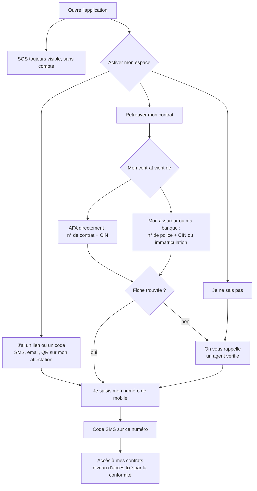

# Particuliers : classification et activation (version de travail)

Date : 26 novembre 2026. Statut : à valider par le responsable du studio, puis avec AFA.
Contexte : la plupart des clients particuliers n'ont ni téléphone ni email dans les fichiers d'AFA. On se concentre sur eux (décision du 26/11).

## 1. Ce qu'on sait, ce qu'on suppose

- On sait : les anciens clients ont été enregistrés sans téléphone ni email.
- On suppose (à vérifier) : la plupart des particuliers passent par un partenaire (assureur, banque, mutuelle) et ne connaissent pas le nom AFA.
- On ne sait pas : quels champs existent vraiment fiche par fiche (CIN, date de naissance, immatriculation, n° de contrat AFA, n° de police du partenaire).

## 2. Classification proposée

On classe selon trois questions : par où la personne est couverte, ce qu'AFA sait d'elle, et ce qu'elle a en main.

| Groupe | Qui | Ce qu'AFA a sans doute | Ce que la personne a en main | Piste d'activation |
|---|---|---|---|---|
| P1 · Acheteur en ligne | Assurance voyage ou visa achetée sur le site | Nom, email, téléphone (saisis à l'achat) | Attestation PDF, email | Lien ou code par email ou SMS. Le cas facile |
| P2 · Client direct en agence ou chez un courtier | Contrat direct AFA (auto, voyage, santé) | Nom, n° de contrat, peut-être CIN ou immatriculation | Contrat papier, attestation, carte | Code ou QR sur le document, ou « Retrouver mon contrat » |
| P3 · Client d'un partenaire | Assistance incluse dans un contrat Sanlam, La Marocaine Vie, une carte bancaire… | Ce que le partenaire transmet (souvent peu) | Contrat du partenaire, carte bancaire, numéro d'assistance | Lien envoyé par le partenaire, ou n° de police partenaire + CIN ou immatriculation |
| P4 · Personne en difficulté sans compte | N'importe lequel des groupes, au moment d'un SOS | Rien d'exploitable sur le moment | Son téléphone | SOS sans compte, puis lien d'activation par SMS après l'appel |
| P5 · Sans smartphone | Téléphone simple ou pas de téléphone | Variable | Contrat papier | Pas d'application : téléphone, SMS de suivi, agence |

Le groupe P3 est probablement le plus grand. C'est aussi celui où le partenaire peut tout débloquer, s'il transmet les contacts.

## 3. Principes

1. Le SOS ne dépend jamais du compte. Tout le monde peut appeler et être aidé, activé ou pas.
2. L'activation est progressive : chaque contact (appel au plateau, agence, renouvellement, achat en ligne) sert à récupérer le numéro.
3. Un seul point d'entrée, « Activer mon espace », avec plusieurs portes selon ce que la personne a en main.
4. Toujours un repli humain : si la fiche n'est pas trouvée, « on vous rappelle ».
5. On ne demande que des identifiants qu'AFA possède vraiment (à confirmer par l'état des données).

## 4. Parcours « Activer mon espace » (esquisse)

Le niveau de vérification (accès complet tout de suite, accès limité, ou validation par un agent) est une décision des équipes juridique et conformité d'AFA.

## 5. Questions ouvertes

Voir la page Notion « Questions pour AFA · particuliers sans contact ».
