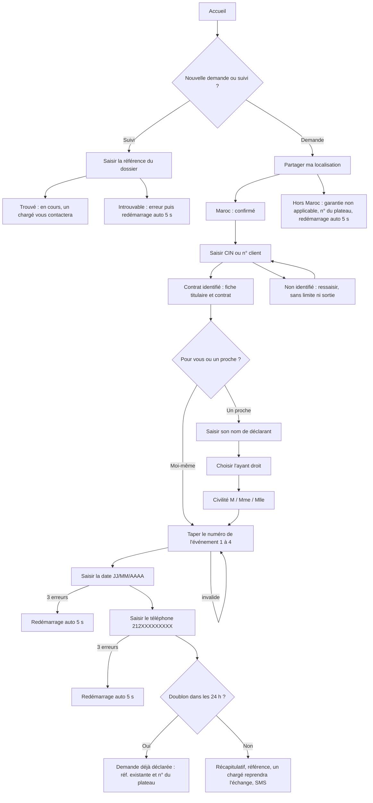

# Analyse du chatbot WhatsApp · Al Amana Assistance (démo v2)

Date : 27 novembre 2026. Source : démo HTML fournie par le responsable du studio, non versionnée dans le dépôt (document client, version « mono-contrat, moi-même, passage direct à l'événement »). Analyse faite sur le code complet de la démo : chaque branche a été relevée.

## Ce que c'est
- Canal : WhatsApp, au nom du partenaire « AL AMANA – Assistance ». AFA est derrière (B2B2C).
- Produit : Tayssir Al Amana (prêt individuel), assistance en cas de maladie, accident, hospitalisation ou décès, au Maroc.
- Langue : français uniquement.
- 7 étapes annoncées, avec barre de progression.

## Carte des scénarios

## Les 9 fins possibles

| # | Scénario | Fin | Ce que vit la personne |
|---|---|---|---|
| S1 | Suivi, dossier trouvé | Message « en cours » | Aucune étape ni délai : elle attend toujours |
| S2 | Suivi, référence introuvable | Redémarrage auto en 5 s | Tout est effacé, sans autre moyen de retrouver son dossier |
| S3 | Demande, personne hors du Maroc | Refus, puis redémarrage auto en 5 s | Le numéro du plateau disparaît avant qu'elle ait pu le noter |
| S4 | CIN ou n° client non reconnu | Boucle de ressaisie | Ni aide sur le format, ni accès à un conseiller |
| S5 | Pour moi-même | Dossier créé, référence | Succès en 7 étapes |
| S6 | Pour un proche | Dossier créé, référence | Succès, avec 3 questions de plus |
| S7 | Date invalide 3 fois | Redémarrage auto en 5 s | Tout est perdu après 5 étapes |
| S8 | Téléphone invalide 3 fois | Redémarrage auto en 5 s | Tout est perdu à la dernière étape |
| S9 | Doublon dans les 24 h | Arrêt, référence existante | Pas de statut du dossier existant |

## Vérification exhaustive (relecture ligne par ligne)

### Les points de décision
| # | Étape | Branches | Qui décide dans la démo |
|---|---|---|---|
| D1 | Accueil | Demande / Suivi | La personne |
| D2 | Suivi : référence | Trouvé / Introuvable | Simulé (règle réelle inconnue) |
| D3 | Position | Maroc / Hors Maroc | Simulé |
| D4 | CIN ou n° client | Identifié / Non identifié (boucle) | Simulé |
| D5 | Pour qui | Moi-même / Un proche (3 ayants droit × 3 civilités) | La personne |
| D6 | Événement | 4 choix, ou saisie invalide (boucle) | La personne |
| D7 | Date | Valide / invalide ≤ 2 fois / 3 fois → redémarrage | Règle de la démo |
| D8 | Téléphone | Valide / invalide ≤ 2 fois / 3 fois → redémarrage | Règle de la démo |
| D9 | Doublon 24 h | Non / Oui | Simulé |

Au total : 9 fins, 2 boucles sans sortie (CIN non reconnu, numéro d'événement invalide), et 40 combinaisons de succès (moi-même × 4 événements, plus 3 ayants droit × 3 civilités × 4 événements). Quatre décisions (D2, D3, D4, D9) sont simulées : les vraies règles côté AFA sont à connaître.

### Saisies testées avec les règles exactes de la démo
| Saisie | Résultat | Problème |
|---|---|---|
| Date « 1/5/2025 », « 14.05.2025 », « 14 05 2025 », « 14/05/25 » | Refusée | Façons courantes d'écrire une date |
| Date « 31/02/2025 », « 31/04/2025 » | **Acceptée** | Date qui n'existe pas |
| Date « 01/01/1900 » | **Acceptée** | Aucune borne : ni ancienneté maximale, ni début du contrat |
| Téléphone « +212662456089 » | Refusé | Format international standard |
| Téléphone « 0662456089 », « 06 62 45 60 89 » | Refusé | Façon dont les Marocains écrivent leur numéro |
| Téléphone « 00212662456089 » | Refusé | Format courant depuis l'étranger |
| Téléphone « 212 662 45 60 89 » | Accepté | Espaces et tirets tolérés : bien |
| Événement « 01 », « 1. », « un », « Maladie » | Refusé | Réponses naturelles |

### Scénarios absents de la démo
1. **Un proche déclare pour le titulaire.** La liste des ayants droit ne contient pas le titulaire. Si Khadija est hospitalisée ou décédée, son conjoint ne peut pas déclarer pour elle : il doit choisir « Moi-même », et le dossier ne garde aucune trace de qui déclare. C'est le cas le plus probable pour un décès.
2. **Pas de confirmation avant création du dossier.** Le récapitulatif s'affiche une fois le dossier créé, sans bouton « Modifier » ni « Confirmer ». Aucune réponse ne peut être corrigée en cours de route.
3. **Fins sans issue.** Après « dossier trouvé », après un doublon et après un succès, la conversation s'arrête : pas de retour au menu, pas d'autre demande possible.
4. **Messages libres.** Sur un vrai WhatsApp, la personne peut écrire, envoyer un vocal ou une photo à tout moment. La démo ne gère aucun de ces cas. Les vocaux en darija sont très courants.
5. **Refus de partager la position**, ou position impossible à obtenir : aucune option pour écrire sa ville ou son adresse.
6. **Reprise après une pause.** Rien ne dit ce qui se passe si la personne revient une heure plus tard au milieu du parcours.
7. **Plusieurs contrats.** Cette version ne gère qu'un contrat par client.
8. **Sécurité.** Le CIN seul suffit pour déclarer au nom de quelqu'un.
9. **L'icône téléphone de l'en-tête** est décorative : aucun bouton n'appelle le plateau.

## Ce qui marche
1. Accueil clair avec deux intentions : nouvelle demande ou suivi.
2. Barre de progression « Étape x / 7 » (heuristique 1, visibilité de l'état).
3. Le contrat est retrouvé avec le CIN, puis affiché : la personne voit qu'on l'a reconnue.
4. « Moi-même » saute la ressaisie du nom : on ne redemande pas ce qu'on sait.
5. Les ayants droit du contrat sont proposés en liste, au lieu d'être tapés.
6. Les erreurs expliquent la cause (format, date future, indicatif) et le nombre d'essais.
7. Contrôle des doublons dans les 24 h, avec la référence existante.
8. Récapitulatif complet, référence du dossier, confirmation par SMS.

## Problèmes, par gravité

### Critiques
1. **Redémarrage automatique en 5 secondes qui efface tout** (S2, S3, S7, S8). La personne perd ses réponses et, en S3, le numéro du plateau. Heuristique 3 (contrôle et liberté), heuristique 9 (récupération des erreurs), WCAG 2.2.1 (temps réglable).
2. **Aucun chemin d'urgence.** Une hospitalisation en cours ou un décès passe par les mêmes 7 étapes, sans bouton « appeler maintenant ». Le plateau ne rappelle « que dans les meilleurs délais ».
3. **Le décès est traité comme les autres événements.** On peut choisir « Moi-même » puis « Décès ». Pas de ton adapté, pas de passage direct à une personne.

### Majeurs
4. **On redemande le téléphone.** Sur WhatsApp, le numéro de la personne est déjà connu, puisqu'elle écrit depuis ce numéro. Le format est aussi très strict (212 sans + ni 0), alors que les gens écrivent 06… (heuristique 5, prévention des erreurs).
5. **La date se tape à la main au format JJ/MM/AAAA**, avec 3 essais. Des boutons « Aujourd'hui », « Hier », « Autre date » éviteraient presque toutes les erreurs.
6. **L'événement se choisit en tapant un chiffre**, alors que le reste du parcours utilise des boutons (heuristique 4, cohérence). WhatsApp permet des listes à choix.
7. **La position est demandée en premier**, avant de savoir qui est la personne et ce qui se passe. Sans autre option si elle refuse de la partager ou si le GPS ne répond pas.
8. **Hors du Maroc, c'est un refus sec.** Pas d'orientation, alors que la personne est peut-être malade à l'étranger.
9. **CIN non reconnu : impasse.** Ni exemple du format attendu, ni passage vers un conseiller (heuristique 9).
10. **Le suivi ne marche qu'avec la référence**, et la réponse ne dit ni l'étape, ni le délai (heuristique 1). On pourrait retrouver le dossier par le numéro WhatsApp ou le CIN.

### Mineurs
11. Français uniquement : pas d'arabe ni de darija, alors que les clients du microcrédit en ont souvent besoin.
12. La civilité est demandée pour un ayant droit déjà connu dans le contrat ; « Mlle » est daté.
13. Le nom du déclarant est tapé librement, sans lien demandé avec l'assuré.
14. Les animations « en train d'écrire » ajoutent environ 20 secondes à un parcours d'urgence.
15. Aucune mention du consentement pour la position et les données.

## Ce que ça veut dire pour l'application AFA
- **Le canal WhatsApp ou l'app sait déjà beaucoup.** Dans l'app, l'identité, le contrat, le téléphone et la position sont connus. Les étapes 2, 3 et 7 du chatbot disparaissent. Le SOS se réduit à : pour qui, quoi, confirmer, puis la timeline.
- **À garder :** le choix de l'ayant droit dans une liste, le contrôle des doublons, le récapitulatif avec référence, les messages d'erreur qui expliquent.
- **À corriger dans l'app comme dans le bot :** jamais de redémarrage automatique, un chemin d'urgence direct, un parcours spécifique pour le décès, des choix au lieu de saisies libres, un suivi avec étapes et délais.
- **Une piste pour les clients sans téléphone ni email dans les fichiers :** sur WhatsApp, le numéro de la personne arrive avec son message. Le chatbot peut servir de porte d'entrée et de rattachement, et envoyer ensuite le lien d'activation de l'application.
- **Les types d'événements dépendent du produit.** Tayssir couvre maladie, accident, hospitalisation et décès. L'auto et le voyage auront leurs propres listes : l'application doit les adapter au contrat.

## Questions pour AFA et Al Amana
- Ce chatbot est-il en service, ou encore une démo ? Combien de demandes passent par lui ?
- Que se passe-t-il côté plateau après le récapitulatif : qui rappelle, et en combien de temps ?
- Le numéro WhatsApp de la personne peut-il être utilisé directement au lieu de le redemander ? (informatique, juridique)
- Existe-t-il une version multi-contrats, et une version en arabe ?
- Pourquoi la garantie est-elle limitée au Maroc, et que doit-on dire à une personne à l'étranger ?
